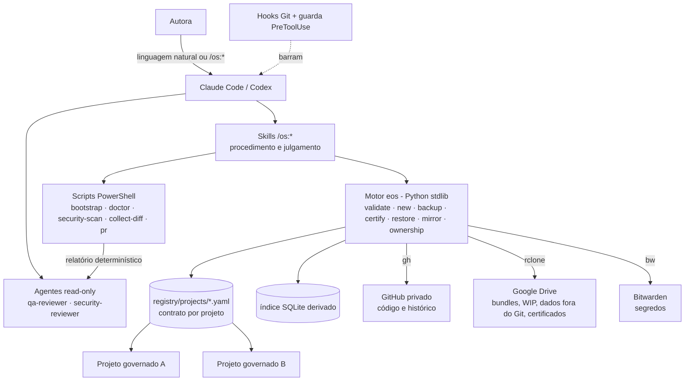

# Emmily AI Project OS

> **Summary in English.** Emmily AI Project OS is a personal "operating system" for AI-assisted software projects, built on top of Claude Code (with Codex as a second agent). It is distributed as a Claude Code plugin (`/os:*` commands) plus a stdlib-only Python engine (`eos`) and a set of PowerShell scripts, hooks and test suites. It creates new projects with a protected birth (Git, private remote, contract, cloud folder, backup), keeps the project state in the repository instead of in chat history, enforces "builder ≠ evaluator" with read-only QA and security reviewer agents fed by deterministic collectors, scans for secrets and third-party personal data, and certifies each project's portability on an L0–L6 scale by actually restoring it in isolation and running its smoke test. Every architectural choice is recorded in 19 ADRs. This public copy is sanitized: client identifiers, local paths and the real project registry were replaced by fictional examples.

Plataforma pessoal que padroniza como cada projeto desenvolvido com IA é criado, versionado, verificado, protegido e retomado — em qualquer máquina, conta ou sessão.

## Problema

Projetos feitos com assistentes de IA tendem a ter o estado **na conversa**, não no repositório. Na auditoria inicial do ambiente (`docs/audits/2026-09-05-fase0-auditoria.md`) o quadro era:

- repositórios só locais, sem remoto, com backup por ZIP manual;
- nenhum `STATE.md`, decisões espalhadas dentro de `CLAUDE.md`;
- regra de ouro do commit ("só quando eu pedir") dependendo de o modelo lembrar;
- nenhum teste de que um projeto sobrevive à perda do chat, da máquina ou da conta;
- dados corporativos e de terceiros convivendo com código sem varredura sistemática.

## Solução

**Projeto ≠ sessão.** O repositório é a fonte de verdade; o chat é descartável. A plataforma entrega:

| Peça | O que faz |
|---|---|
| Plugin Claude Code `os` | 7 skills invocáveis como `/os:new-project`, `/os:resume`, `/os:checkpoint`, `/os:status`, `/os:handoff`, `/os:security`, `/os:doctor` |
| Motor `eos` (Python stdlib) | registry de contratos YAML, backup/restore conferidos por hash, `certify` (restauração isolada + smoke), níveis L0–L6, ownership & provenance, nascimento protegido (`eos new`), cofre de segredos via Bitwarden CLI |
| Agentes revisores | `qa-reviewer` e `security-reviewer` **estritamente read-only**, alimentados por coletores determinísticos (ADR-0007, ADR-0008) |
| Scanner de segurança | segredos, CPF/CNPJ com dígito verificador, e-mails de terceiros, exposição de remoto, `.gitignore`, histórico do Git; escada de severidade e exceções estreitas que **não silenciam** (ADR-0009, ADR-0010) |
| Hooks | `commit-msg`, `pre-commit`, `pre-push` versionados + guarda `PreToolUse` contra git destrutivo (`hooks/guarda_git.py`) |
| Template | `templates/project-standard/` com contrato de portabilidade, harness de testes e manifesto `project.yaml` |
| Memória versionada | `docs/STATE.md`, ADRs, `docs/sessions/`, `CHANGELOG.md` e protocolo `/session-start` / `/session-close` |

## Arquitetura



Regra de alocação (`docs/ARCHITECTURE.md` §3): **se depende de julgamento, é skill ou agent; se é sempre igual, é script; se não pode ser esquecido, é hook.**

Referência técnica completa: [`docs/architecture/EMMILY-AI-PROJECT-OS-TECHNICAL-REFERENCE.md`](docs/architecture/EMMILY-AI-PROJECT-OS-TECHNICAL-REFERENCE.md). Guia de uso: [`docs/user/`](docs/user/README.md).

## Números

| Métrica | Valor | Fonte |
|---|---|---|
| Casos de teste PowerShell (`Test-Caso`) | 504, coleta completa 504/504 | cabeçalho de `docs/STATE.md` (conferido contra o disco por `tests/suites/docs.ps1`) |
| Testes `unittest` do motor `eos` | `Ran 371 tests ... OK (skipped=1)` na coleta r14/r16 (anterior; em 19/11/2026: 375 OK, 2 skipped — ver Verificação) | `docs/STATE.md` |
| ADRs | 19 | `docs/decisions/` |
| Skills / agentes | 7 skills, 2 agentes revisores | `docs/STATE.md` (Parcial) |
| Projetos governados no fechamento do vNext | 30 contratos válidos; 22/22 PROJECT em L6 SAFE | `docs/FINAL-ACCEPTANCE.md` |
| Rodadas de revisão independente da guarda de git | r14–r18, código APROVADO por QA e Security | `docs/FINAL-ACCEPTANCE.md` |
| Linhas de código (motor + scripts + hooks) | ≈ 15,4 mil (`wc -l`) | código desta cópia |

> Na versão pública o registry real foi trocado por 3 contratos fictícios e 1 teste foi marcado `skip`, então uma execução aqui mostra `skipped=2` e `3 contrato(s) valido(s)`.

## Como rodar (com os dados fictícios)

Requisitos: Windows 10/11, PowerShell 5.1, Git 2.55+, Python 3.13 (launcher `py`). Detalhes em [`docs/SETUP.md`](docs/SETUP.md).

```powershell
# valida os contratos fictícios de registry/projects/
py -3.13 -m eos validate
# -> 3 contrato(s) valido(s), 0 erro(s)

# ensaio do nascimento protegido de um projeto (não cria nada)
py -3.13 -m eos new exemplo-novo --name "Exemplo Novo" --category LAB --runtime python --sem-remoto --sem-rede --dry-run

# testes do motor, um arquivo por vez
py -3.13 -m unittest eos.tests.test_contract eos.tests.test_novo

# suítes PowerShell da plataforma (pesadas: rode uma por vez)
.\tests\run-tests.ps1 -Suite docs
```

Para usar como plugin: `.\scripts\bootstrap.ps1` (cria a árvore do workspace, ativa os hooks de Git) e registre o marketplace local conforme `docs/SETUP.md`. Integrações reais (GitHub privado, Google Drive via rclone, Bitwarden) exigem login próprio (gates H1, `docs/user/14-HUMAN-GATES.md`).

## Limitações conhecidas

- Feito para **Windows + PowerShell 5.1**; os scripts e as suítes `.ps1` não foram portados para Linux/macOS.
- Os revisores `qa-reviewer` e `security-reviewer` só são acionáveis por `claude -p --agent <nome> --plugin-dir <repo>`; com a sessão OAuth do CLI expirada não há revisão independente (`docs/STATE.md`, "Pendências e limitações conhecidas").
- O fluxo de branch/PR é **client-side**: branch protection e rulesets exigem GitHub Pro em repositório privado, então não há enforcement no servidor (ADR-0011).
- `claude plugin eval` estava em early access e indisponível na conta; a infraestrutura de evals não foi construída sobre ele.
- O hook `pre-commit` varre o repositório inteiro, não só o que está em staging; o custo cresce com o projeto (`docs/STATE.md`, item 97).
- Integrações reais (GitHub privado, Google Drive via rclone, Bitwarden) exigem login próprio; nesta cópia o registry é fictício e 1 teste fica em `skip`.
- A coleta completa do motor é pesada (876 s em 19/11/2026); as suítes PowerShell devem rodar uma por vez.

## O que eu decidi × o que a IA gerou

O código, os scripts, os testes e boa parte da documentação foram **gerados com Claude Code (e Codex) sob minha direção e revisão**; os papéis de QA e segurança foram executados por agentes separados do builder (ADR-0007). As decisões abaixo são minhas e estão registradas.

| Decidido pela autora | Onde está |
|---|---|
| Workspace único com migração progressiva, sem mover nada às pressas | ADR-0001 |
| GitHub pessoal **privado por padrão**, inclusive para trabalho corporativo; nada corporativo publicado automaticamente | ADR-0003 |
| Distribuir como plugin (um comando `/os:*` funciona onde o projeto ainda não existe) | ADR-0004 |
| Escopo enxuto da Fase 1 (5 de 11 skills) e tag só após validação ponta a ponta | ADR-0005, ADR-0006 |
| **Builder ≠ evaluator**, revisores read-only e coletores determinísticos | ADR-0007, ADR-0008 |
| Aceitar uma exceção de segurança estreita em vez de reescrever histórico — sem silenciar o achado e sem valer para publicação | ADR-0010 |
| Programa vNext: continuidade antes de novas features; Drive como plano de dados; "o Git guarda o projeto, o Drive guarda o dado" | ADR-0012, ADR-0013, ADR-0015 |
| Motor em Python **só stdlib**, registry em YAML por projeto, níveis L0–L6 derivados de fato medido | ADR-0014 |
| Ownership & provenance informativa, por nome, com assinatura SSH | ADR-0018 |
| Gates humanos (H1–H4): login, limpeza com prova, sanitização de histórico, proveniência | `docs/user/14-HUMAN-GATES.md`, `docs/STATE.md` |
| Regra de ouro do Git: nunca commitar sem pedido explícito | `CLAUDE.md` |

| Gerado pela IA, sob revisão | Como foi verificado |
|---|---|
| Motor `eos/` e seus testes `unittest` | coletas completas registradas no `docs/STATE.md`; revisões QA/Security por rodada |
| Scanner, coletores, doctor, hooks e scripts de PR em PowerShell | suítes em `tests/suites/`, testes de mutação registrados no STATE |
| Skills, agentes, template e manuais em `docs/user/` | suítes `skills`, `agents`, `template`, `docs`; retomada em sessão limpa sem histórico |

O `docs/STATE.md` mantém, de propósito, o registro dos defeitos que a revisão independente achou no próprio código gerado (falsos verdes, guardas mais estreitos que o título) — é a evidência de que a revisão não foi decorativa.

## Stack

PowerShell 5.1 · Python 3.13 (stdlib) · Git 2.55 / GitHub CLI · rclone (Google Drive) · Bitwarden CLI · SQLite · Claude Code (plugins, skills, subagentes, hooks) · Codex · gitleaks (verificação externa da cópia pública)

## Estrutura

```
.claude-plugin/   plugin.json e marketplace.json (tornam /os:* global)
skills/           os comandos /os:* (cada skill é um procedimento)
agents/           qa-reviewer e security-reviewer (read-only)
eos/              motor vNext em Python stdlib + eos/tests/
scripts/          bootstrap, doctor, security-scan, collect-diff, branch/pr, hooks
githooks/ hooks/  hooks de Git e guarda PreToolUse do plugin
templates/        esqueleto dos projetos governados
registry/         contratos YAML (na versão pública: só exemplos fictícios)
docs/             STATE, ARCHITECTURE, VISION, ADRs, manuais, referência técnica
tests/            suítes PowerShell da plataforma
```

## Verificação, sanitização e licença

- **Testes:** `py -3.13 -m unittest discover -s eos/tests -t .` → **375 testes OK (2 skipped)** em 19/11/2026. As suítes PowerShell estão em "Como rodar".
- **Dados:** registry e exemplos fictícios; identificadores de clientes, caminhos locais e o registry real foram substituídos.
- **Sanitização:** o que foi removido, trocado ou inventado nesta cópia está em [`SANITIZACAO.md`](SANITIZACAO.md).
- **Licença:** todos os direitos reservados; leitura permitida para avaliação de portfólio — ver [`LICENSE`](LICENSE) e [`NOTICE`](NOTICE).

## Aviso

*Dados fictícios. Versão sanitizada de um sistema em uso real; identificadores do cliente foram substituídos.* O nome do contrato corporativo aparece como "Programa" (categoria `PROG`), os projetos privados foram renomeados ou removidos e o registry contém apenas exemplos. Contato: perfil GitHub [@Emmilymaciell](https://github.com/Emmilymaciell).
