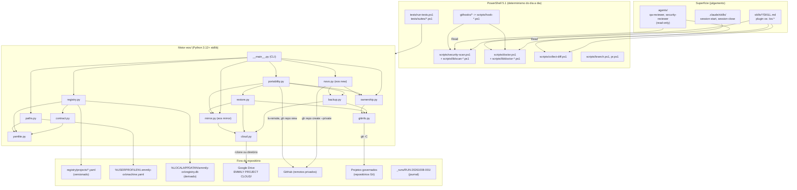
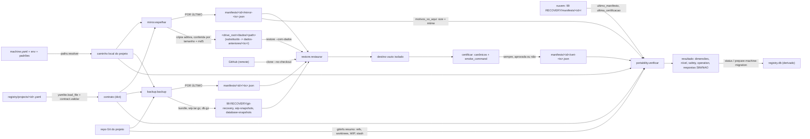

# Emmily AI Project OS — Referência técnica

> **Para quem é:** a próxima IA ou engenharia que for manter esta plataforma **sem** acesso a
> nenhuma conversa. Tudo aqui foi conferido contra o código do commit `16f611e` (`main`,
> 2026-10-11); as partes de ownership, `eos new`, assinatura no doctor e `REFERENCE_DATA` foram
> reconferidas contra `9f3e17f` (branch `vnext`, 2026-10-12). O espelho de dados (`eos mirror`,
> `restore --com-dados`) e as correções da rodada r9 (ownership, `eos new`, guarda AST, doctor,
> scanner, `refs/preservado/*`) foram conferidos contra `e3da8e1` (branch `vnext`, 2026-10-12).
> Cada afirmação de comportamento cita `arquivo:função`. Onde o código e um documento
> existente divergem, a divergência está na seção 31, e **o código vence** até que alguém decida o
> contrário em ADR.
>
> **O que este documento não é:** não é fonte de decisão (isso é `docs/decisions/`), nem de
> estado (isso é `docs/STATE.md` e `docs/vnext/EXECUCAO.md`), nem de política de verificação (isso
> é `docs/VERIFICATION-POLICY.md`). Ele descreve **como o sistema funciona** e onde mexer.
>
> **Ownership e `eos new`** (seção 28) foram escritos primeiro a partir da especificação e
> conferidos depois contra o código integrado; onde o código difere da especificação, vale o
> código, e a diferença está na seção 31.

---

## Sumário

1. Princípios que o código impõe
2. Mapa de componentes
3. Fluxo de dados
4. Comandos e códigos de saída
5. Motor `eos/`, módulo a módulo
6. Registry e índice SQLite derivado
7. Contrato v1, campo a campo
8. Backup engine
9. Recovery engine
10. Abstração de nuvem
11. Camada GitHub
12. Camada Drive
13. Portabilidade: dimensões, escada L0–L6, segurança × operação
14. Certificação
15. "Saúde": o que existe e o que não existe
16. Caminhos portáveis
17. Ciclo de sessão e skills
18. Agentes revisores
19. Scanner de segurança
20. Hooks de Git
21. Doctor
22. Testes e prova por mutação
23. Journals do programa
24. Locks e concorrência
25. Recuperação de falha
26. Modelo de segurança
27. Assinatura de commits
28. Ownership e `eos new`
29. Como estender
30. Armadilhas conhecidas
31. Divergências encontradas entre documentação e código
32. Índice de arquivos

---

## 1. Princípios que o código impõe

Não são slogans: cada um tem um mecanismo concreto, citado.

| Princípio | Onde está no código |
|---|---|
| **O repositório é a fonte de verdade; o chat é descartável.** | `registry/projects/*.yaml` é canônico (`eos/registry.py:carregar`); o índice SQLite é derivado e nunca lido (`eos/registry.py:rebuild_index`). |
| **"Não consegui verificar" nunca é "passou".** | Dimensão `UNKNOWN` bloqueia o nível (`eos/portability.py:verificar`); `gitinfo` levanta `GitErro` em vez de devolver vazio (`eos/gitinfo.py:ls_remote`, `:stash`, `:git` com timeout); scanner, doctor, hooks e runner usam o código `2` para "não rodou" (ADR-0009). |
| **Falhar fechado na leitura.** | `eos/yamlite.py` recusa recurso de YAML que não entende; `eos/contract.py:_valida_mapa` recusa campo desconhecido. |
| **Nenhum verbo destrutivo no motor.** | `eos/cloud.py` não tem `delete`/`sync`; `RcloneStore.put` usa `--immutable`; o espelho de dados é `rclone copy` (nunca `sync`) e leva a versão substituída para `--backup-dir` antes (`eos/cloud.py:RcloneStore.enviar_lote`); guarda AST em `eos/tests/test_guardas.py:analisar`. |
| **Upload só conta conferido.** | `eos/cloud.py:DirStore.put` (sha256), `:RcloneStore.put` (md5 do servidor) e, no espelho, inventário tamanho + md5 depois da cópia (`eos/mirror.py:espelhar`). |
| **O manifesto é o ponto de commit do backup.** | `eos/backup.py:backup` grava `manifests/<id>/<ts>.json` por último. |
| **Tudo que vem da nuvem é dado não confiável.** | `eos/restore.py:_validar_manifesto`, `:_caminho_seguro`, `:_ref_valida`. |
| **Leitura sem escrita no projeto.** | `GIT_OPTIONAL_LOCKS=0` e ambiente sem `GIT_*` herdado (`eos/gitinfo.py:_ambiente`); SQLite aberto com `mode=ro` (`eos/backup.py:snapshot_sqlite`). |
| **Commit só com pedido explícito.** | Regra de `CLAUDE.md`, não mecanismo. Nenhum script da plataforma faz `git commit`. |

---

## 2. Mapa de componentes



Regra de alocação que vale desde a Fase 1 (`docs/ARCHITECTURE.md` §3): **julgamento → skill ou
agente; sempre igual → script; não pode ser esquecido → hook.** O motor `eos/` é a extensão desse
"script" para o que o PowerShell 5.1 não faz bem (YAML, SQLite, tar/gzip, hash de streaming) —
ADR-0014.

Fronteira entre as duas linguagens (ADR-0014, Consequências): **PowerShell** para o que já
existia e para o Git do dia a dia (scanner, doctor, hooks, fluxo de branch/PR); **Python** para o
motor de continuidade. O motor **não** chama os scripts PowerShell, com uma exceção: o
`smoke_command` da certificação roda em `powershell -NoProfile -ExecutionPolicy Bypass -Command`
(`eos/portability.py:certificar`).

---

## 3. Fluxo de dados



O ciclo fecha em si mesmo: `verificar` lê o manifesto e o certificado que `backup` e `certificar`
gravaram. Por isso a dimensão `recovery` (L6) e a dimensão `backup` (L3) dependem só do que está na
nuvem **e** do estado atual do disco, nunca de um campo escrito no contrato. O espelho de dados
segue a mesma regra: "posso apagar a pasta?" lê o último `mirror-<ts>.json` com `ok: true` e o
`stat` da pasta, nunca um campo do contrato.

---

## 4. Comandos e códigos de saída

### 4.1 Motor: `py -3.13 -m eos <comando>`

Rodar a partir da raiz do repositório da plataforma (o pacote é `eos/`). Python **3.12+** é
obrigatório: `eos/__main__.py:exigir_python` aborta antes de qualquer coisa (o motor usa
`shutil.rmtree(onexc=)` e `tarfile.extractall(filter="data")`). Use `py -3.13` explicitamente:
nesta máquina o 3.12 está no `PATH` e o 3.13 é o padrão do launcher.

| Comando | O que faz | Escreve | Saída |
|---|---|---|---|
| `validate` | Valida todos os contratos, não estrito (`registry.carregar(estrito=False)`) | nada | `0` todos válidos · `1` algum inválido · `2` registry ausente, `machine.yaml` ilegível |
| `status [--sem-rede]` | `verificar` em cada item; uma linha por item | índice SQLite | `0` todo `PROJECT` com `seguro_trocar_computador` · `1` qualquer `PROJECT` sem · `2` erro de uso/registry inválido |
| `check <id> [--json] [--sem-rede]` | Um projeto, com dimensões, bloqueios e as três respostas | nada | `0` se `seguro_apagar_clone` · `1` caso contrário (inclusive item não-`PROJECT`) · `2` id desconhecido |
| `backup <id>... \| --todos` | `backup.backup` por projeto; `--todos` = só `type: PROJECT` | nuvem, staging local | `0` todos completos · `1` algum `incompleto` ou com exceção (inclusive id desconhecido) · `2` registry inválido, transporte indisponível |
| `certify <id> [--manter]` | Restore isolado + verificações + smoke; grava `cert-<ts>.json` | nuvem, `%TEMP%\eos-cert-<id>-<ts>` (removido salvo `--manter`) | `0` aprovada · `1` reprovada · `2` id desconhecido |
| `restore <id> --para <dir> [--fonte auto\|cloud\|github] [--com-dados]` | Restaura no destino (vazio ou inexistente). `--com-dados`: depois do Git/WIP/bancos, baixa o último espelho `cloud-mirror` com `ok: true` para `<dir>/<path>` e confere tamanho + md5 de cada arquivo (seção 9.3) | destino | `0` verificado · `1` com falha (inclui dado divergente, conflito com arquivo que o Git trouxe, ou nenhum espelho verificado) · `2` sem `--para`, `RestoreErro`, `NuvemErro`, `MirrorErro` |
| `mirror <id>... \| --todos` | Espelha os `data[]` `cloud-mirror` em `<drive_root>/dados/<path>` (`mirror.espelhar`, seção 5.14); `--todos` = só `PROJECT` com algum `cloud-mirror` | nuvem: `<drive_root>/dados/`, `<drive_root>/dados-anteriores/<ts>/`, `99 RECOVERY/manifests/<id>/mirror-<ts>.json`; journal `%LOCALAPPDATA%\emmily-os\mirror\<id>\<ts>.json`. Nunca escreve no projeto nem apaga na nuvem | `0` todos com `ok: true` · `1` algum manifesto gravado com `ok: false` (divergência, arquivo mudou durante, erro de cópia) · `2` sem alvo, id desconhecido, ou algum projeto com `MirrorErro`/`NuvemErro`/`CaminhoNaoResolvido`/`OSError` (os demais continuam) |
| `prepare-machine-migration` | `status` + lista do que bloqueia cada projeto | índice SQLite | igual a `status`; imprime "Nada foi alterado" |
| `index` | Reconstrói o índice derivado | índice SQLite | `0` |
| `resolve <texto>` | Resolve `${VARS}` nesta máquina | nada | `0` · `2` variável sem valor |
| `new <id> --name "<nome>" --category <CAT> [--runtime python\|node\|none] [--sem-remoto] [--sem-rede] [--dry-run] [--certificar] [--descricao "<frase>"]` | Nascimento protegido (seção 28.5); `--sem-rede` implica `--sem-remoto` | projeto novo, `registry/projects/<id>.yaml` (sem commit na plataforma), GitHub, nuvem, diário em `%LOCALAPPDATA%\emmily-os\novo\`; `--dry-run` não escreve nada | `0` nasceu ou plano · `1` nasceu com pendência (H2, certificação reprovada) · `2` recusado ou parou num passo |
| `ownership-check <id> [--json]` | Titularidade declarada × fatos (seção 28.2) | nada | `0` sem FAIL · `1` com FAIL · `2` sem id, id desconhecido |
| `ownership-init <id>` | Gera os arquivos de proveniência que faltam num projeto existente (`ownership.gerar_arquivos`). A pasta vem de `paths.caminho_local` (override do `machine.yaml` > `workspace.local_path`), o mesmo caminho de `check`/`backup`; recusa pasta inexistente e pasta que não seja a **raiz** de um repositório Git (`rev-parse --show-toplevel`) — nunca cria a pasta do projeto | só arquivos novos no projeto; nunca sobrescreve; não commita | `0` ok · `2` sem seção ownership, pasta inexistente, não é raiz de repo, erro |
| `ownership-certify <id> [--tag]` | Check + certificado de ownership (seção 28.3) | nuvem `99 RECOVERY/manifests/<id>/ownership-<ts>.json`, journal `%LOCALAPPDATA%\emmily-os\ownership\<id>\`; com `--tag`, tag assinada no projeto | `0` gravado · `1` recusado · `2` erro |
| `help`, `-h`, sem argumento | Imprime o docstring | nada | `0` |
| outro | — | nada | `2` |

Exceções capturadas por `eos/__main__.py` (saída `2`, mensagem `ERRO:` em stderr):
`paths.CaminhoNaoResolvido`, `ValueError` (inclui `yamlite.YamlErro` e registry inválido),
`KeyError`, `cloud.NuvemErro`, `restore.RestoreErro`, `ownership.OwnershipErro`,
`gitinfo.GitErro` (os dois desde `fcb0dc0`) e `mirror.MirrorErro` (desde `e3da8e1`). **Qualquer outra exceção** (por exemplo
`IndexError` por argumento faltando em `check`/`certify`/`restore`, `RuntimeError` genérico) sai
com traceback e código `1` do interpretador — ver seção 30.

### 4.2 Scripts PowerShell

Todos seguem o contrato do ADR-0009: **`0` passou, `1` reprovou, `2` não conseguiu verificar**, e
`2` barra exatamente como `1`.

| Script | `0` | `1` | `2` |
|---|---|---|---|
| `scripts/security-scan.ps1` | nenhum ALTA/MEDIA fora de exceção aprovada | algum ALTA ou MEDIA | erro de execução, detector ausente, não é repo |
| `scripts/doctor.ps1` | global `PASS` ou `WARN` | global `FAIL` | global `INCONCLUSIVO` ou o doctor não rodou |
| `scripts/collect-diff.ps1` | relatório sem lacuna | relatório com lacuna | erro, sem relatório |
| `tests/run-tests.ps1` | todos os casos passaram | algum falhou | suíte desconhecida ou **nenhum caso executado** |
| `scripts/hook-pre-commit.ps1` | códigos do scanner, sem reinterpretação | | |
| `scripts/hook-commit-msg.ps1` | mensagem passa | problema estrutural | não verificou |
| `scripts/hook-pre-push.ps1` | tudo que a política pediu passou | alguma verificação reprovou | alguma não rodou, ou política ilegível |
| `scripts/install-hooks.ps1` | instalado/já estava | `-Verificar` com falta, ou `hooksPath` em outro lugar sem `-Reparar` | não conseguiu determinar |
| `scripts/branch.ps1`, `scripts/pr.ps1` | fez/respondeu | recusou (guarda-corpo, portão) | não conseguiu determinar (sem `gh`, sem remoto…) |
| `scripts/bootstrap.ps1` | ambiente ok | problemas | — |

---

## 5. Motor `eos/`, módulo a módulo

Python só com a stdlib (ADR-0014, item 1): o motor precisa rodar numa máquina recém-formatada,
antes de qualquer `pip`, porque é ele quem restaura o resto. O guarda `test_so_stdlib`
(`eos/tests/test_guardas.py`) falha se aparecer `import` fora da stdlib.

### 5.1 `eos/__init__.py`
Só `__version__ = "0.1.0"` e o docstring do pacote.

### 5.2 `eos/__main__.py` — CLI
- `main(argv)`: despacho por `argv[0]`. Remove `--sem-rede` dos argumentos antes de tudo.
  Carrega `machine.yaml` sempre (`paths.carregar_maquina`). Para comandos que não sejam
  `resolve`/`validate`/`index`, constrói o transporte de nuvem (`cloud.store_da_maquina`) — a
  construção do `RcloneStore` não chama o rclone; `drive-desktop` sem unidade montada levanta
  `NuvemErro` já aqui.
- `exigir_python(versao=None)`: `SystemExit` se `< 3.12`.
- Formatação: `_linha_check` (uma linha por projeto, com a coluna `own`), `_imprimir_check`
  (detalhe), `_imprimir_ownership`.
- `new` é despachado para `novo.cli` **antes** do `registry.carregar()` estrito;
  `ownership-check`/`ownership-certify` sem `<id>` imprimem `uso:` e saem `2`.
- **Invariante:** os comandos de leitura (`status`, `check`, `prepare-machine-migration`) não
  escrevem no projeto nem na nuvem; `status` e `prepare-machine-migration` regravam o índice
  derivado.

### 5.3 `eos/yamlite.py` — subconjunto estrito de YAML
- `loads(texto)`, `load_file(caminho)` (UTF-8; BOM removido), `dumps(obj)`.
- Aceita: mapas e listas em bloco, escalares com aspas duplas (escapes `\\ \" \n \t \/`) e simples
  (`''`), inteiros, `true/false`, `null/~`, `[]` e `{}` **vazios**, comentário `#` em linha própria
  ou após espaço.
- **Recusa com número de linha (`YamlErro`, subclasse de `ValueError`):** TAB na indentação,
  âncora/alias/tag (`& * !`), bloco literal (`| >`), **lista ou mapa de fluxo não vazio**
  (`[a, b]`, `{a: 1}`), chave duplicada, indentação inconsistente, escape desconhecido em aspas
  duplas (a mensagem manda usar aspas simples para caminho Windows).
- `dumps` produz o mesmo subconjunto (round-trip testado em `eos/tests/test_yamlite.py`); é usado
  pelas ferramentas do journal para gerar contratos (`tools/gerar_registry.py`,
  `tools/aplicar_ambiente.py`), não pelo motor.

### 5.4 `eos/contract.py` — schema e validação do contrato v1
- `VERSAO = 1`; vocabulários `TIPOS` (`PROJECT`, `COLLECTION`, `EXTERNAL_SOURCE`, `ARCHIVE`,
  `REFERENCE_DATA`), `CLASSIFICADOS` (todo tipo ≠ `PROJECT`), `CATEGORIAS`, `STATUS`,
  `CRITICIDADE`, `NIVEIS`; `ID_RE`.
- `SCHEMA`: dicionário declarativo `campo -> (tipo, obrigatório, vocabulário|subschema)`. Tipos
  implementados em `_valida`: `str`, `int` (bool não conta), `bool`, `enum`, `strlist`, `map`,
  `list` (lista de mapas). O comentário cita `any`, mas não há ramo para ele.
- `EXIGIDO_POR_TIPO`: seções obrigatórias por `identity.type`.
- `validar(doc, nome_arquivo=None) -> [erros]`: lista vazia = válido. Detalhe na seção 7.
- **Invariante:** validação é pura, exceto pelo import tardio de `gitinfo.permitivel` para
  `secrets.allowed_paths` (que também é puro: não toca em disco).

### 5.5 `eos/registry.py` — registry canônico e índice derivado
- `RAIZ_REPO`: dois níveis acima do arquivo (a raiz da plataforma).
- `pasta(raiz_repo=None)`: `registry/projects`.
- `carregar(raiz_repo=None, estrito=True)`: lê todo `*.yaml` em ordem alfabética.
  `estrito=True` → `{id: contrato}` ou `ValueError` listando **todos** os erros; registry vazio
  também é erro. `estrito=False` → `(itens_validos, erros)`.
- `caminho_indice()`: `%LOCALAPPDATA%\emmily-os\registry.db` (ou `~/.cache/emmily-os/registry.db`).
- `rebuild_index(itens, destino=None, verificacoes=None)`: ver seção 6.

### 5.6 `eos/paths.py` — caminhos portáveis
- `arquivo_da_maquina()`: `EOS_MACHINE_FILE` ou `%USERPROFILE%\.emmily-os\machine.yaml`.
- `carregar_maquina(caminho=None)`: dict com `vars`, `projects`, `_arquivo`, `_existe`.
  Arquivo ausente **não** é erro (devolve vazio com `_existe: False`).
- `padroes()`, `resolver(texto, maquina=None, extras=None)`, `caminho_local(contrato, maquina)`.
- `CaminhoNaoResolvido(ValueError)`.
- `CANONICAS` e `hardcodes(texto)` existem mas **não são usados** por nenhum módulo nem teste.
- Detalhe na seção 16.

### 5.7 `eos/gitinfo.py` — fatos de Git, sem escrever no repositório
Toda chamada passa por `git(repo, *args, check=True, binario=False, timeout=600)`:
- ambiente sem nenhuma variável `GIT_*` herdada, mais `GIT_OPTIONAL_LOCKS=0`,
  `GIT_TERMINAL_PROMPT=0`, `LC_ALL=C` (`_ambiente`);
- configuração fixada em toda chamada (`FIXOS`): `core.fsmonitor=false`, `core.quotepath=false`,
  cores desligadas, `diff.noprefix=false`, `diff.mnemonicPrefix=false`, `diff.relative=false`;
- todo `diff` ganha `--no-ext-diff --no-color --no-textconv`;
- timeout vira `GitErro` ("não consegui ler", nunca resposta); `check=True` com código ≠ 0 vira
  `GitErro`; com `check=False` devolve `(rc, stdout)`.

Funções públicas (todas leitura):

| Função | Devolve | Observação |
|---|---|---|
| `remover_arvore(path)` | `bool` (o caminho deixou de existir) | **Única remoção** do módulo; só para árvores criadas pelo motor; trata `.git` somente-leitura |
| `eh_repo`, `tem_commit` | `bool` | `tem_commit` usa `HEAD^{commit}` |
| `refs(path)` | `{refname: sha}` | todas as refs locais |
| `refs_do_projeto(todas)` | idem, sem `refs/remotes/*` e sem `refs/stash` | o que é "trabalho do projeto" |
| `remotos`, `remotos_completos` | URLs de fetch/push por remoto | lê `remote -v`, aceita URL com espaço |
| `stash(path)` | entradas | `refs/stash` sem reflog conta como 1; falha levanta |
| `ls_remote(path, remoto="origin")` | `{ref: sha}` | sem rede levanta, nunca `{}` |
| `eh_ancestral`, `objeto_existe` | `bool` | |
| `nao_publicados(path, refs_remotas)` | refs do projeto que o remoto não tem | branch: igual ou ancestral do remoto; tag e demais: igual. **Exceção deliberada:** `refs/preservado/*` (constante `PRESERVADO`, desde `4336efa`) nunca conta como não publicada — é a convenção para ref local que protege conteúdo que **não pode** ir ao remoto (ex.: stash órfão anterior a uma sanitização). Ela nunca é publicada; a proteção dela é o bundle da nuvem (`bundle --all`), e a dimensão `backup` continua exigindo que o bundle a contenha |
| `worktrees(path)` | lista do `worktree list --porcelain` | |
| `permitivel(rel)` | texto do erro ou `None` | regra de `secrets.allowed_paths` |
| `nome_de_segredo(rel, permitidos=())` | `bool` | **regra única** de nome de segredo |
| `segredos_no_historico(path, permitidos)` | caminhos | `log --all -m --exclude=refs/stash` |
| `gitlinks(path)` | submódulos (modo 160000) | |
| `wip(path, excluir, worktrees_internas, permitidos)` | dict de listas | ver seção 8.3 |
| `ignorados_nao_declarados(path, declarados)` | caminhos | `status --ignored=traditional -uall` |
| `sha256_arquivo(p)` | hex | streaming de 1 MiB |
| `impressao_wip(path, w=None, excluir=None)` | hex | impressão digital do WIP |
| `resumo(path, excluir, permitidos)` | fatos do projeto inteiro | árvore principal + worktrees |

Regra de nome de segredo (`NOME_DURO`, `NOME_PALAVRA`, `EXEMPLO_OK`) — olha **só o nome do
arquivo**, nunca as pastas:
- **dura**, sem exceção: `.env`, `.env.*`, `.envrc`, `id_rsa|dsa|ecdsa|ed25519(.pub)`, `.netrc`,
  `.pgpass`, `.npmrc`, `.pypirc`, `rclone.conf`, arquivos de perfil de navegador
  (`login data`, `web data`, `cookies`, `local state`, `logins.json`, `key3.db`, `key4.db`) e as
  extensões `pem key pfx p12 ppk jks keystore kdbx ovpn`;
- **da palavra**, em qualquer extensão: `secret(s)`, `token(s)`, `credential(s)`, `senha(s)`,
  `password(s)`, `passwd`, `api_key(s)`/`apikey(s)`, `cookie(s)` como palavra (delimitada por não
  letra);
- **exceção por nome exato:** `.env.example|sample|template`, `secrets.manifest`, `cofre.manifest`;
- **exceção por caminho exato:** `secrets.allowed_paths` do contrato, só para a família da palavra.

### 5.8 `eos/cloud.py` — nuvem como serviço lógico
Detalhe na seção 10. Classes `DirStore`, `RcloneStore`; funções `descobrir_drive_desktop`,
`store_da_maquina`; erro `NuvemErro(RuntimeError)`. Desde `e3da8e1`, os dois transportes também
têm as operações em lote do espelho de dados: `inventario`, `enviar_lote` e `baixar_lote`
(seção 10.1).

### 5.9 `eos/backup.py` — backup
Detalhe na seção 8. Públicas: `carimbo`, `mtime_do_banco`, `snapshot_sqlite`, `empacotar_wip`,
`ultimo_manifesto`, `ultima_certificacao`, `backup`; constantes `RECOVERY = "99 RECOVERY"`,
`ROTULO_RE`, `AVISO_CRIPTOGRAFIA`. `ultimo_manifesto` ignora `cert-*`, `ownership-*` e `mirror-*`,
que moram na mesma pasta `manifests/<id>/` e, sem o filtro, ordenariam depois do `<ts>` e virariam
o "último backup".

### 5.10 `eos/restore.py` — restore
Detalhe na seção 9. Pública: `restaurar(..., com_dados=False)`; internas do `--com-dados`:
`_planejar_dados` (valida o espelho antes de qualquer escrita) e `_baixar_dados` (baixa e
confere); erro `RestoreErro(RuntimeError)`; constantes `SHA_RE`, `RESERVADOS`.

### 5.11 `eos/portability.py` — check e certify
Detalhe nas seções 13 e 14. Públicas: `verificar`, `certificar`; constantes
`PASS/WARN/FAIL/UNKNOWN`, `CERT_VALIDADE_DIAS = 30`.

### 5.12 `eos/ownership.py` — titularidade declarada e proveniência
Detalhe nas seções 28.1–28.4. Públicas: `verificar`, `certificar`, `ultimo_certificado`,
`fatos_assinatura`, `autores`, `explicado`, `contradicoes`, `arquivos_de_ownership`,
`secao_padrao`, `gerar_arquivos` (nunca sobrescreve sem `sobrescrever=True`), `journal_padrao`,
`rel_ledger`; erro `OwnershipErro(RuntimeError)`; constantes `ITENS`, `SIGNING`.

### 5.13 `eos/novo.py` — nascimento protegido (`eos new`)
Detalhe na seção 28.5. Públicas: `planejar` (puro), `nascer`, `cli`, `imprimir`, `nome_repo`,
`caminho_bruto`, `comando_retomar`, `dir_estado_padrao`; `Dependencias` (injeção de `gh`, git de
rede, varredura de segurança e store); erros `NovoErro(ValueError)`, `PassoFalhou`,
`RemotoPendente`; mapas `BASE_WORKSPACE`, `DRIVE_ROOT`, `PREFIXO_REPO`; detecção de pasta
sincronizada `_na_nuvem_sincronizada` (`NUVEM_EXATA`, `NUVEM_RE`).

### 5.15 `eos/cofre.py` — segredos no Bitwarden (`eos secrets-push|pull|status`)

- `resolver_bw()` (PATH, depois o diretório do WinGet), `status(bw, sessao)` (`unauthenticated`/`locked`/`unlocked`).
- `push(contrato, maquina, store, bw, sessao)`: sem sessão desbloqueada → `SemSessao` (gate H1, saída 2);
  `bw sync`; cada `.env`/`.env.local` vira Secure Note `emmily-os/<id>/<arquivo>` (notes = arquivo, campo
  `sha256`); JSON só por **stdin** (`bw encode` → `bw create|edit item`); relê e confere o sha256
  (`ConferenciaFalhou`); grava `99 RECOVERY/manifests/<id>/cofre-<ts>.json` = nomes das variáveis + sha256,
  **sem valores**. `BW_SESSION` só no ambiente do filho; erros redigidos.
- `pull(...)`: escreve na raiz (ou `--para`), recusa conteúdo diferente sem `--sobrescrever`, recusa destino
  Git que não ignora o `.env`, aceita só nomes `.env`/`.env.local` vindos do cofre.
- `verificar_cofre(contrato, store)`: sem rede; usado por `portability._so_nesta_pasta` quando
  `secrets.store == "bitwarden"` (motivo some só se cada `.env` local bate com o último `cofre-*`).
- `backup.ultimo_manifesto` ignora `cofre-*`. Testes: `eos/tests/test_cofre.py` (bw falso que grava argv e
  recusa conteúdo em argv; nenhum valor em stdout/stderr/argv/nuvem).
- Limite conhecido: não exercitado contra o `bw` real até o H1; notas do Bitwarden têm limite de ~10k
  caracteres cifrados. O `bw sync` passa pelo wrapper `_rodar`, que o guarda AST não inspeciona.

### 5.14 `eos/mirror.py` — espelho de dados `cloud-mirror` (`eos mirror`)
Introduzido em `e3da8e1` (ADR-0013/0015; emenda de 2026-10-12 no ADR-0014). Dado fora do Git com
cópia **conferida** na nuvem.

| Peça | Valor |
|---|---|
| origem | `<caminho_local>/<data.path>` (pasta ou arquivo), caminho de `paths.caminho_local` |
| destino | `<cloud.drive_root>/dados/<data.path>` (`destino`); sem `drive_root` declarado → `MirrorErro`, nada é copiado |
| versão substituída | `<drive_root>/dados-anteriores/<ts>/<data.path>` |
| manifesto | `99 RECOVERY/manifests/<id>/mirror-<ts>.json` (`rel_manifesto`), gravado por último, relido e comparado |
| journal da máquina | `%LOCALAPPDATA%\emmily-os\mirror\<id>\<ts>.json` (`journal_padrao`), fora do Git e da nuvem |

Públicas:
- `caminhos(contrato)`: `data[].path` com `policy: cloud-mirror`.
- `pendentes(contrato)`: `data[].path` com `decisao_pendente: true`. `espelhar` não as copia
  (estado `decisao-pendente` no manifesto, `pendentes` no resultado, `MirrorErro` se todas forem
  pendentes) e `motivos_so_aqui` devolve `dado com decisao pendente: <path>` mesmo com espelho
  antigo ok (r10).
- `separar(contrato)` (r11): `(alvos, pendentes)` entre os `cloud-mirror`, normalizados. É
  pendente a entrada marcada **ou** a que está dentro de (ou é igual a) qualquer caminho pendente
  de qualquer policy (`_dentro`, comparação por `_caixa`). `espelhar` e `motivos_so_aqui` usam
  essa separação; o check acusa a de dentro como `dado com decisao pendente: <path> (dentro de
  caminho pendente)`.
- `credencial_no_conteudo(full)`: lê arquivo de até 2 MB, texto UTF-8 ou UTF-16 (com BOM, ou sem
  BOM detectado pelo NUL em posição alternada; `_decodificar`), e devolve o nome do primeiro
  padrão de `PADROES_CREDENCIAL` que casa (os prefixos de `scan-comum.ps1` mais Slack, Google,
  string de conexão com senha/`AccountKey`, URL `esquema://usuario:senha@` e
  `senha=`/`password=` com valor). `espelhar` recusa o arquivo (`credencial no conteudo`).
  `OSError` na leitura propaga e `espelhar` recusa o arquivo com `MSG_ILEGIVEL` (falha fechada,
  r11). **Limite declarado:** arquivo > 2 MB e binário (NUL fora do padrão UTF-16) não são lidos e
  sobem.
- `validar_path(p)`: normaliza para `/`; recusa vazio, absoluto, unidade (`:`), `.`/`..`,
  componente vazio e componente terminado em espaço ou ponto (o Windows os descarta; r12)
  (`MirrorErro`).
- `invalidos(contrato)` (r12): mensagens de `data[].path` inválido em **qualquer** entrada, de
  qualquer policy. Falha fechada nos três consumidores: `separar`/`aninhados` (logo `espelhar`)
  levantam `MirrorErro` antes de qualquer envio; `motivos_so_aqui` devolve os pendentes mais as
  mensagens e **não** avalia nenhum alvo (nada conta como protegido); `restore --com-dados`
  (`_planejar_dados`) converte em `RestoreErro` antes de escrever no destino. A validação do
  contrato (`contract.validar`, seção 7.2) já recusa o mesmo caminho na carga do registry.
- `aninhados(contrato, p)`: `data[]` de **outra** policy dentro de `p` (ex.: `output/TESTE` com
  `none` dentro de `output`) e, desde a r11, todo `data[]` com `decisao_pendente` dentro de `p`,
  qualquer que seja a policy. Não sobe e não conta como "só nesta pasta": o contrato já disse o
  que fazer com ele. Vai para `paths.<p>.excluidos` no manifesto. No Windows a comparação ignora
  caixa (`os.path.normcase`), inclusive na exclusão do inventário.
- `inventario_local(raiz, p, permitidos, excluir)`: `(tipo, {chave: (size, mtime_ns)}, recusados)`;
  `tipo` ∈ `dir`, `arquivo`, `link`, `None` (não existe). **Não lê conteúdo.** Recusa symlink
  **e junção NTFS** (`_eh_link`: `os.path.islink` ou `os.path.isjunction`) — a pasta-raiz e as
  subpastas não são seguidas — e todo nome que `gitinfo.nome_de_segredo` acusa (com
  `secrets.allowed_paths`).
- `ultimo_espelho(store, pid, so_ok=True)`: o `mirror-*.json` mais recente com `ok: true` e
  `project == pid`, lendo no máximo `MAX_LIDOS = 20` manifestos de trás para frente; `None` se não
  há.
- `espelhar(contrato, store, maquina=None, journal=None, log=print)`: o comando. Ver abaixo.
- `motivos_so_aqui(contrato, raiz, store)`: o que o check usa (seção 13.3).
- `unidade(p, tipo)` / `sub(chave, prefixo)`: a pasta copiada como unidade (a própria pasta, ou o
  pai do arquivo) e a chave relativa a ela. As chaves do manifesto são relativas ao **projeto**.

**`espelhar`, passo a passo** (por `data.path`):
1. Inventário local (size, mtime) e md5 de cada arquivo (`cloud._md5`).
2. `store.inventario(destino)` — `{subcaminho: (bytes, md5)}`; no rclone, numa chamada
   `lsjson --hash`, sem baixar nada.
3. **Incremental:** só sobe o que, no destino, não tem o mesmo tamanho **e** md5. O que já existe
   com outro conteúdo é "substituído".
4. `store.enviar_lote(base, lista, destino, anteriores)` — cópia **aditiva**: com substituições,
   `anteriores = <drive_root>/dados-anteriores/<ts>/<prefixo>` recebe a versão antiga **antes**.
   Nada é apagado na nuvem; arquivo que sumiu daqui continua lá.
5. **Verificação depois da cópia:** novo `store.inventario` e comparação arquivo a arquivo
   (tamanho **e** md5) contra o local; mais um `stat` local para detectar arquivo que mudou
   durante o espelho. Divergência, arquivo faltando, arquivo que mudou, `NuvemErro` ou `OSError`
   → `estado: falhou` daquele path.
6. Manifesto (`manifest_version: 1`): `project, ts, maquina` (só o hostname), `source_path` (`"."`:
   desde a r10 nunca o caminho absoluto da máquina; as chaves já são relativas ao projeto),
   `completed_at, ok, recusados[]` e, por path, `estado` (`ok`, `falhou`, `ausente`, `recusado`,
   `decisao-pendente`), `destino`, `tipo`,
   `arquivos{chave: [size, mtime_ns, md5]}`, `enviados`, `ja_presentes`, `substituidos`,
   `excluidos`, `divergentes` e `mudaram_durante` (até 50 cada), `erro` (desde a r11 passado por
   `paths.redigir_caminhos`: raiz do projeto → `.`, pasta do usuário → `~`, sem caixa e pelo nome
   curto 8.3). `ok` = todo path em `ok`, `ausente`, `recusado` ou `decisao-pendente`. Manifesto com `ok: false` é **gravado** (evidência), mas não conta para
   nada.
7. Dois espelhos no mesmo segundo não dividem `<ts>` (`_carimbo_livre` espera o próximo).

**Invariantes:** nunca escreve no projeto; nunca apaga nem sincroniza na nuvem; nome de segredo e
link nunca sobem (viram `recusados` e continuam acusados pelo check); o check nunca faz rede além
de ler o último manifesto. Testes: `eos/tests/test_mirror.py`.

---

## 6. Registry e índice SQLite derivado

**Fonte de verdade:** um YAML por item em `registry/projects/<id>.yaml`, versionado, no
subconjunto do `yamlite`. Em `9f3e17f` há 29 arquivos: 21 `PROJECT`, 4 `COLLECTION`, 3 `ARCHIVE`,
1 `EXTERNAL_SOURCE`, 0 `REFERENCE_DATA`; categorias Programa 16, PERSONAL 4, LAB 3, UNIVERSITY 3,
PORTFOLIO 2, PLATFORM 1. Todo `PROJECT` tem seção `ownership`.

**Carga** (`eos/registry.py:carregar`): ignora o que não termina em `.yaml`; erro de YAML ou de
contrato entra na lista com o nome do arquivo; o id do contrato tem de bater com o nome do arquivo
(`contract.validar`), o que impede id duplicado.

**Índice derivado** (`eos/registry.py:rebuild_index`): grava em `<destino>.tmp`, faz `commit` e
`os.replace` para o destino (troca atômica no mesmo volume). Duas tabelas:

```sql
create table item (id text primary key, name text, type text, category text, status text,
                   criticality text, local_path text, remote text, drive_root text,
                   target_level text, contrato text);   -- contrato = JSON completo
create table verificacao (id text primary key, nivel text, safety text, operation text,
                          json text);                    -- resultado de portability.verificar
```

Quem regrava: `eos index` (só `item`), `eos status` e `eos prepare-machine-migration` (`item` +
`verificacao`). **Nenhum código lê o índice.** Ele existe para consulta humana e ferramentas
externas, pode ser apagado a qualquer momento e não viaja (fica em `%LOCALAPPDATA%`).

---

## 7. Contrato v1, campo a campo

O contrato declara **intenção** (ADR-0014, item 3). Estado medido — nível, saúde, último backup —
não mora nele: é derivado por `portability.verificar` a cada execução.

### 7.1 Campos

`O` = obrigatório quando a seção existe. Tipos: `str`, `int`, `bool`, `enum`, `strlist` (lista
de textos), `map`, `list` (lista de mapas).

| Campo | Tipo | O | Vocabulário / significado |
|---|---|---|---|
| `contract_version` | int | sim | só `1` é aceito |
| `identity.id` | str | sim | `^[a-z0-9][a-z0-9-]{1,62}$` e igual ao nome do arquivo |
| `identity.name` | str | sim | |
| `identity.type` | enum | sim | `PROJECT`, `COLLECTION`, `EXTERNAL_SOURCE`, `ARCHIVE` |
| `identity.category` | enum | sim | `PLATFORM`, `PROG`, `PERSONAL`, `UNIVERSITY`, `PORTFOLIO`, `LAB` |
| `identity.status` | enum | sim | `active`, `paused`, `archived` |
| `identity.criticality` | enum | sim | `low`, `medium`, `high` |
| `identity.description`, `identity.owner` | str | não | |
| `workspace.local_path` | str | sim | caminho com `${VARS}`; sobrescrevível por máquina |
| `workspace.onedrive_synced` | bool | não | |
| `git.enabled` | bool | sim | |
| `git.default_branch` | str | não | |
| `git.remote` | str | não | `""` = sem remoto **declarado**; se preenchido, `https://github.com/<owner>/<repo>[.git]` |
| `git.visibility` | enum | não | `private`, `public`, `none`; `public` com remoto é **erro** (ADR-0003) |
| `git.worktrees_policy` | enum | não | `preserve-all`, `none` (declarativo; o motor sempre protege todas as worktrees) |
| `cloud.drive_root` | str | sim | relativo à raiz lógica, ex. `01 PROG/prog-relatorio-g2` |
| `external_sources[]` | list | não | `id` (str, O), `type` (`sharepoint`, `onedrive`, `graph-api`, `web`, `other`, O), `role` (str, O), `required_for_operation` (bool, O), `location` (str) |
| `state.strategy` | enum | sim | `git-only`, `sqlite`, `files` |
| `state.databases[]` | list | não | `path` (O), `engine` (`sqlite`, O), `max_age_hours` (int) |
| `data[]` | list | não | `path` (O), `policy` (`cloud-mirror`, `reproducible`, `external`, `none`, O), `note`, `decisao_pendente` (bool; `true` = a titular ainda não decidiu se o dado pode ir à nuvem: `eos mirror` recusa a entrada e o check acusa `dado com decisao pendente: <path>`, qualquer que seja a policy — r10, S-A1) |
| `environment.runtime` | enum | sim | `python`, `node`, `powershell`, `mixed`, `none` |
| `environment.version`, `.manifest`, `.bootstrap`, `.test_command`, `.smoke_command` | str | não | `manifest` é caminho relativo ao projeto; `smoke_command` roda no restore |
| `secrets.manifest` | str | sim | arquivo versionado com **nomes**, nunca valores |
| `secrets.store` | enum | sim | `bitwarden`, `local-env`, `none` |
| `secrets.allowed_paths` | strlist | não | caminhos exatos (seção 26.3) |
| `backup.wip` | enum | sim | `snapshot`, `none` (declarativo: o motor empacota WIP sujo independentemente) |
| `backup.max_age_hours` | int | não | declarado; **não lido** pelo motor (só `state.databases[].max_age_hours` é) |
| `backup.exclude` | strlist | não | prefixos que não sobem (nem inteiros, nem em patch) |
| `ai.canonical` | strlist | sim | arquivos neutros de provedor; base do L5 |
| `ai.adapters` | strlist | não | `CLAUDE.md`, `AGENTS.md`…; declarativo |
| `portability.target_level` | enum | sim | `L0`…`L6`; declarativo (indexado, não usado na escada) |
| `certification` | map | não | `level`, `date`, `commit`, `evidence` (O), `restored_from` — **nenhum código escreve nem lê** (seção 31) |
| `notes` | strlist | não | |

### 7.2 Regras transversais (`eos/contract.py:validar`)

1. Topo tem de ser mapa; campo desconhecido em qualquer nível é erro; valor `null` em campo
   obrigatório conta como ausente.
2. `contract_version` diferente de `1` → "não suportada".
3. `identity.id` fora do padrão, ou diferente do nome do arquivo.
4. Seções exigidas por tipo (`EXIGIDO_POR_TIPO`):
   - `PROJECT`: `workspace`, `git`, `cloud`, `backup`, `portability`;
   - `COLLECTION`: `workspace`, `cloud`;
   - `ARCHIVE`: `cloud`;
   - `EXTERNAL_SOURCE`: nada.
5. `git.remote` preenchido + `visibility: public` → erro.
6. `git.remote` preenchido e fora de `https://github.com/<owner>/<repo>` → erro.
7. `external_sources[].type == sharepoint` com `role == backup` num `PROJECT` → erro (SharePoint
   nunca é backup).
8. Cada `secrets.allowed_paths` passa por `gitinfo.permitivel`: relativo, sem `..`, sem curinga,
   nunca da família dura, e tem de ser da família da palavra (senão a exceção é desnecessária).
9. Cada `data[].path` passa por `motivo_caminho_relativo` (r12): relativo e literal, sem unidade,
   `..`, `.`, componente vazio, componente terminado em espaço ou ponto, nem caractere de
   glob/pathspec. Antes era descartado em silêncio na comparação com o pendente.

Todos os erros são acumulados; `registry.carregar(estrito=True)` mostra todos de uma vez.

---

## 8. Backup engine (`eos/backup.py:backup`)

### 8.1 Três necessidades, três artefatos

| Artefato | Caminho na raiz lógica | Conteúdo |
|---|---|---|
| A. histórico | `99 RECOVERY/git-recovery/<id>/<ts>/<id>.bundle` | `git bundle create --exclude=refs/stash --all`, seguido de `bundle verify` |
| B. WIP | `99 RECOVERY/wip-snapshots/<id>/<ts>/wip.tar.gz` | WIP de **todas** as worktrees sujas num único tar.gz |
| C. estado | `99 RECOVERY/database-snapshots/<id>/<ts>/<nome>.gz` | snapshot SQLite consistente, gzip nível 6 |
| manifesto | `99 RECOVERY/manifests/<id>/<ts>.json` | **gravado por último** |

`<ts>` = `carimbo()`: UTC, `%Y%m%dT%H%M%SZ`. Os nomes ordenam lexicograficamente no tempo, e é
assim que `ultimo_manifesto` escolhe o mais recente (último nome que não começa com `cert-`).

### 8.2 Sequência

```mermaid
sequenceDiagram
  participant CLI as eos backup
  participant BK as backup.backup
  participant GI as gitinfo
  participant ST as staging local (EOS_STAGING)
  participant CL as store (nuvem)
  CLI->>BK: contrato, store, maquina
  BK->>BK: caminho_local; erro se não existe
  BK->>GI: resumo(raiz, exclude, allowed_paths)
  Note over BK: não é repo → RuntimeError (sem manifesto)
  BK->>GI: segredos_no_historico → pendências
  alt tem commit
    BK->>ST: bundle create --exclude=refs/stash --all; bundle verify
    BK->>GI: todo HEAD de worktree é ancestral de alguma ref? senão RuntimeError
    BK->>CL: put(bundle) + conferência de hash
  end
  alt alguma worktree suja
    BK->>ST: empacotar_wip → wip.tar.gz (+ índice, pendências)
    BK->>CL: put(wip.tar.gz) + conferência
  end
  loop state.databases
    BK->>ST: mtime_origem; snapshot_sqlite (mode=ro, API backup, integrity_check)
    BK->>CL: put(<db>.gz) + conferência
  end
  BK->>BK: pendências → incompleto: true
  BK->>CL: escrever_texto(manifests/<id>/<ts>.json)  ← ponto de commit
  BK->>ST: remover_arvore(staging/<id>/<ts>)
```

### 8.3 WIP (`eos/backup.py:empacotar_wip` sobre `eos/gitinfo.py:wip`)

`gitinfo.wip` classifica a saída de `status --porcelain=v1 -z --untracked-files=all --no-renames`:

| Lista | Critério | Destino |
|---|---|---|
| `excluidos` | não rastreado dentro de `.venv`, `venv`, `node_modules`, `__pycache__`, `.pytest_cache`, `.mypy_cache`, `.git` | não sobe (reconstruível) |
| `excluidos_contrato` | sob prefixo de `backup.exclude` (rastreado ou não) | não sobe; vira "só nesta pasta" no check |
| `removidos` | `D` e o arquivo não existe | o restore apaga no destino |
| `symlinks` | é link | pendência: não protegível |
| `aninhados` | diretório (repo aninhado/submódulo sujo) que não é worktree interna | pendência: não protegível |
| `nao_rastreados` | `??` | sobe inteiro |
| `modificados` | o resto, mais `escondidos` (`skip-worktree`/`assume-unchanged` com conteúdo diferente do índice) | sobe inteiro |
| `intencao` | status `' A'` (`git add -N`) | o restore refaz o `-N` |
| `segredos` | `nome_de_segredo` entre modificados, não rastreados e removidos | **não sobe**; pendência |

Layout do tar, por worktree suja, com rótulo único (`_rotulos`: `main` só para a principal):
`<rotulo>/status.txt`, `<rotulo>/staged.patch`, `<rotulo>/unstaged.patch` (os dois só se há
commit; ambos com pathspec que **exclui** cada segredo e cada `backup.exclude`), e
`<rotulo>/files/<caminho>` para cada modificado/não rastreado que não é segredo.

**Conferência de consistência:** depois de empacotar, recalcula o `diff --cached` e o sha256 de
cada arquivo empacotado; se algo mudou durante o backup, `RuntimeError("... rode de novo")` — o
backup aborta antes do manifesto.

**Impressão digital do WIP** (`gitinfo.impressao_wip`): sha256 sobre, em ordem, caminho + sha256 de
cada modificado e não rastreado; os rótulos `removidos`, `aninhados`, `symlinks`, `intencao` com
seus caminhos; e o sha256 do `diff --cached --binary`. Muda se e só se o trabalho não commitado
muda. É o que o L3 compara entre o disco e o manifesto, e o que o restore confere no destino.

### 8.4 Bancos (`snapshot_sqlite`, `mtime_do_banco`)

- `mtime_origem` é lido **antes** do snapshot e é o maior mtime entre `<db>`, `<db>-wal` e
  `<db>-journal` (em WAL o commit vai para o `-wal`).
- Snapshot pela API `Connection.backup` com origem `mode=ro`, depois `PRAGMA integrity_check` no
  snapshot; diferente de `ok` → `RuntimeError` (backup aborta).
- Banco declarado e inexistente → registro com `erro: nao existe` + pendência.

### 8.5 Manifesto (`manifest_version: 1`)

| Campo | Conteúdo |
|---|---|
| `project`, `timestamp`, `completed_at` | id; carimbo de início; carimbo de fim |
| `source_path`, `machine` | caminho local e `COMPUTERNAME` (o L3 usa os dois para saber se o snapshot de banco é desta origem) |
| `client_side_encryption`, `aviso` | sempre `false` e o texto de `AVISO_CRIPTOGRAFIA` |
| `branch`, `head`, `unborn` | estado do HEAD principal |
| `refs` | todas as refs locais **menos** `refs/stash` |
| `stash` | número de entradas (não protegidas) |
| `segredos_no_historico` | caminhos com nome de segredo em qualquer commit alcançável (só se há commit) |
| `artifacts.git_bundle`, `artifacts.wip` | `{rel, sha256, bytes}`; `sha256` é do arquivo **local** |
| `worktrees[]` | `caminho, principal, branch, head, locked, sujo, impressao_wip` |
| `wip_index[]` | `rotulo, caminho, branch, head, impressao_wip, arquivos{rel: sha256}, removidos, excluidos (contagem), nao_enviados, intencao` |
| `databases[]` | `path, engine, mtime_origem, integrity_check, tabelas, sha256_db (descompactado), bytes_db, rel, sha256 (gz), bytes` — ou `path, engine, erro` |
| `pendencias[]`, `incompleto` | o que o motor **não** protegeu; `incompleto: true` se houver qualquer uma |

O que vira pendência (e portanto `incompleto`): nome de segredo no histórico (até 20 listados),
submódulo/gitlink, stash, segredo no WIP, repo aninhado, symlink, banco declarado ausente.

### 8.6 Hashes

| Momento | Algoritmo | Onde |
|---|---|---|
| depois do upload (diretório) | sha256 remoto × local | `cloud.DirStore.put` |
| depois do upload (rclone) | md5 do servidor (`lsjson --hash`) × md5 local | `cloud.RcloneStore.put` |
| registro no manifesto | sha256 do arquivo local | `backup.backup` |
| antes de usar no restore | sha256 baixado × manifesto | `restore._baixar_conferido` |
| arquivo do WIP | sha256 do índice × arquivo extraído | `restore.restaurar` |
| banco restaurado | sha256 descompactado × `sha256_db`, mais `integrity_check` | `restore.restaurar` |
| espelho de dados, depois da cópia | tamanho + md5 da nuvem (no rclone, o md5 que o Drive guarda; no `DirStore`, calculado) × local | `mirror.espelhar` |
| espelho de dados, no check | **só** tamanho + `mtime_ns` local × manifesto (sem conteúdo, sem rede além do manifesto) | `mirror.motivos_so_aqui` |
| `restore --com-dados` | tamanho + md5 do arquivo baixado × manifesto do espelho | `restore._baixar_dados` |

---

## 9. Recovery engine (`eos/restore.py:restaurar`)

### 9.1 Regras

1. **Destino isolado:** tem de não existir ou estar vazio; senão `RestoreErro` ("restore nunca
   sobrescreve"). Sobrescrever projeto é gate H3.
2. **Manifesto não confiável:** `_validar_manifesto` antes de qualquer escrita — projeto igual ao
   pedido, `head` é sha de 40 hex (salvo `unborn`), rótulos de worktree casam `ROTULO_RE`, heads de
   worktree são sha, `arquivos` é mapa, `removidos` e `intencao` são listas de texto, e o
   `path` de cada banco passa por `_caminho_seguro`.
3. **Contenção real** (`_caminho_seguro`): recusa caractere de controle, absoluto, unidade, `:`,
   componente vazio/`.`/`..`; recusa qualquer grafia que o NTFS abre como `.git` (`.git` em
   qualquer caixa, com ponto ou espaço no fim, `git~N`) **no texto e no `realpath`**; recusa nomes
   reservados do Windows (`CON`, `PRN`, `AUX`, `NUL`, `COM1-9`, `LPT1-9`) e componentes que terminam
   em espaço ou ponto; recusa symlink no trajeto; exige `commonpath(base, realpath(alvo)) == base`.
4. Branch vinda do manifesto passa por `git check-ref-format --branch` e não pode começar por `-`
   (`_ref_valida`).
5. Repositório restaurado recebe `core.autocrlf=false` e `core.symlinks=false`
   (`_git_init_config`).
6. Temporário `eos-rest-*` em `%TEMP%`, removido no `finally`.
7. **`--com-dados` também é dado não confiável** (`_planejar_dados`, rodado **antes** de qualquer
   escrita, junto com `_validar_manifesto`): cada `data.path` passa por `mirror.validar_path`;
   cada chave do espelho tem de estar dentro do seu `data.path` (ou ser ele, para `tipo:
   arquivo`), passar por `_caminho_seguro` e ter registro `[bytes:int, mtime_ns, md5 de 32 hex]`;
   senão `RestoreErro` e nada é escrito.

### 9.2 Fontes do histórico (`--fonte`)

| `fonte` | Com `git.remote` | Sem `git.remote` |
|---|---|---|
| `auto` (padrão) | `clone --no-checkout` do GitHub, depois `fetch` do bundle com `+refs/heads/*` e `+refs/tags/*` (refs que o remoto não tem) | clone do bundle |
| `cloud` | clone do bundle, depois `fetch` do mesmo bundle | clone do bundle |
| `github` | só GitHub; o bundle é baixado e conferido, mas não usado | `RestoreErro` |

Sem remoto **e** sem bundle → `RestoreErro`. Repositório `unborn` → `git init` (branch padrão
`main`) e `symbolic-ref HEAD` para a branch do manifesto. Valor de `--fonte` fora dos três **não é
rejeitado** e se comporta como `cloud` (seção 30).

### 9.3 Ordem e verificações

1. Histórico; `checkout -B <branch> <head>` (ou `--detach`).
   Verificações: "refs locais iguais ao manifesto" (heads e tags), "HEAD restaurado = HEAD do
   manifesto", e, se havia stash, "stash restaurado" **sempre falso**.
2. WIP: confere sha256 do tar; recusa membro absoluto, com `..` ou que não seja arquivo/diretório;
   `extractall(filter="data")`. Para cada item do índice: `main` vai para o destino; os demais
   para `<destino>/.eos-worktrees/<rotulo>` via `git worktree add`. Aplica `staged.patch` com
   `apply --cached --binary`; copia `files/` conferindo sha256 contra o índice; apaga `removidos`;
   refaz `add --intent-to-add` para `intencao`. Verificação: impressão do WIP restaurado = do
   manifesto; se havia `nao_enviados`, "WIP completo" **falso**. O `unstaged.patch` não é
   aplicado: os arquivos inteiros já cobrem o conteúdo.
3. Bancos: baixa o `.gz`, confere sha256, descompacta num temporário, confere `sha256_db` e
   `integrity_check`; **só então** move para o lugar. Banco sem `rel` no manifesto → verificação
   falsa.
4. Só com `--com-dados` (`_baixar_dados`): usa o **último espelho com `ok: true`**
   (`mirror.ultimo_espelho`). Para cada `data.path` `cloud-mirror`, baixa por
   `store.baixar_lote` para `<destino>/<path>` só o que ainda não existe ali e confere tamanho + md5
   de cada arquivo baixado. Arquivo que o Git/WIP já trouxe com o **mesmo** conteúdo não é
   baixado; com conteúdo **diferente** não é sobrescrito: vira `conflitos` e a verificação
   reprova. Verificação por path: "dados '<path>': tamanho e md5 iguais ao espelho de <ts>",
   com `arquivos`, `baixados`, `divergentes`, `conflitos`, `erro`. Sem nenhum espelho ok na
   nuvem → verificação falsa "nenhum espelho de dados verificado na nuvem"; path sem registro
   `ok`/`ausente` no espelho (ex.: `recusado`) → falsa "sem cópia verificada no espelho".
   Registro `decisao-pendente` no espelho → verificação **verdadeira** "decisao pendente, nao
   restaurado" **só se o contrato atual também tem o path pendente** (`mirror.separar`, r12); se a
   titular já tirou a marca, ou se o manifesto foi adulterado, a marca do manifesto sozinha não
   basta e vale "sem cópia verificada no espelho" (reprova). Qualquer `data[].path` inválido no
   contrato, de qualquer policy, faz o `--com-dados` recusar (`RestoreErro`) antes de escrever.
5. Manifesto `incompleto` → verificação "backup completo" falsa, com as pendências.

`ok` = todas as verificações verdadeiras **e** pelo menos uma verificação (ou `unborn`).

A **certificação não usa `--com-dados`** (`portability.certificar` chama `restaurar` sem ele):
baixar os dados é pesado, e o L6 prova a recuperação do projeto, não a do dado bruto.

---

## 10. Abstração de nuvem (`eos/cloud.py`)

### 10.1 Interface

Ambos os transportes expõem: `tipo`, `descricao()`, `disponivel()`, `put(local, rel)`,
`get(rel, local)`, `existe(rel)`, `listar(rel)`, `ler_texto(rel)`, `escrever_texto(rel, texto)`,
`mkdir(rel)` e, desde `e3da8e1`, as operações em lote do espelho de dados: `inventario(rel,
recursivo=True)`, `enviar_lote(base_local, rels, rel_destino, rel_anteriores=None)` e
`baixar_lote(rel_origem, rels, base_local)`. **Não existe `delete`, `move`, `sync` nem `purge`** —
limpeza é gate H3.

| | `DirStore` | `RcloneStore` |
|---|---|---|
| Raiz | diretório local/montado | `<remote>:<raiz>` |
| `put` | copia para `<dst>.part`, `os.replace`, compara sha256 | `rclone copyto --retries 3 --immutable`, compara md5 do servidor |
| Sobrescrita | **possível** (`os.replace` substitui objeto existente) | conteúdo diferente em objeto existente é **erro** (`--immutable`) |
| Caminho | recusa absoluto, `:` e `..` | recusa `..` |
| `escrever_texto` | UTF-8, `\n`, via `.part` | grava temporário e chama `put` |
| Erro | exceções de SO | `NuvemErro` com as últimas linhas do stderr, sem as do aviso `client_id` (filtro mantido; com o client OAuth próprio, desde 2026-10-16, o aviso não aparece) |
| `inventario` | `os.walk` + md5 calculado; `{}` se a pasta não existe | `rclone lsjson --hash --hash-type md5 --files-only [-R]`, numa chamada, com o md5 que o Drive guarda (nada é baixado); código 3 do rclone = `{}` |
| `enviar_lote` | arquivo a arquivo: se o alvo existe e há `rel_anteriores`, `copyfile` dele para lá **antes**; depois `put` (sha256 conferido) | `rclone copy --files-from-raw <lista> --checksum --retries 3` (**nunca** `sync`); com `rel_anteriores`, `--backup-dir`: o objeto substituído é movido no servidor, nunca apagado. Não usa `--immutable` (substituir é o caso previsto) |
| `baixar_lote` | `get` arquivo a arquivo | `rclone copy --files-from-raw <lista> --checksum --retries 3` para a pasta local |

### 10.2 Seleção do transporte (`store_da_maquina`)

`machine.yaml → cloud.transport`:
- `rclone` (padrão): `RcloneStore(${GDRIVE_REMOTE}, ${GDRIVE_ROOT})` — padrões `gdrive:` e
  `EMMILY PROJECT CLOUD`;
- `drive-desktop`: `DirStore(<mount>/<GDRIVE_ROOT>)`, com `cloud.mount` ou descoberta de
  `<letra>:\Meu Drive` / `<letra>:\My Drive` em todas as unidades (`descobrir_drive_desktop`);
- `dir`: `DirStore(resolver(cloud.path))` — testes, disco externo;
- outro valor → `NuvemErro`.

Provado (ADR-0013): backup gravado por rclone e restaurado pelo Drive Desktop.

### 10.3 Raiz lógica

```
EMMILY PROJECT CLOUD/
  00 PLATFORM/  01 PROG/  02 PERSONAL/  03 UNIVERSITY/  04 PORTFOLIO/  05 LAB/   ← dado bruto
    <id>/                             ← cloud.drive_root do contrato (ex.: 01 PROG/<id>)
      dados/<data.path>               ← espelho cloud-mirror (eos mirror), aditivo
      dados-anteriores/<ts>/<data.path> ← versão que um espelho substituiu (nunca apagada)
  99 RECOVERY/
    git-recovery/<id>/<ts>/<id>.bundle
    wip-snapshots/<id>/<ts>/wip.tar.gz
    database-snapshots/<id>/<ts>/<db>.gz
    manifests/<id>/<ts>.json          ← manifesto de backup
    manifests/<id>/cert-<ts>.json     ← evidência de certificação
    manifests/<id>/ownership-<ts>.json ← certificado de ownership (eos ownership-certify)
    manifests/<id>/mirror-<ts>.json   ← manifesto do espelho de dados (eos mirror)
    disaster-recovery/                ← kit de máquina nova (criado pelo programa, não pelo motor):
                                        machines/notebook-principal.machine.yaml, MAQUINA-NOVA.md,
                                        inventario-repos.txt
    emergency-preservation/           ← criado pelo programa, não pelo motor
```

**"Ledger da nuvem"** (termo do docstring de `eos/contract.py`): na prática é
`99 RECOVERY/manifests/<id>/`. Não existe módulo nem arquivo chamado ledger; os registros são os
manifestos (de backup e de espelho) e os certificados (de portabilidade e de ownership), um JSON por evento, nunca reescritos pelo motor.

---

## 11. Camada GitHub

| Peça | Comportamento |
|---|---|
| Política | Privado por padrão; público só por decisão explícita (ADR-0003). Todo projeto lógico tem remoto privado (ADR-0015, item 1). O Organizador ganhou remoto e continua no OneDrive (ADR-0016). |
| Contrato | `git.remote` só aceita `https://github.com/<owner>/<repo>`; `public` com remoto é erro (`contract.validar`). |
| L2 (`portability.verificar`) | Exige: dimensão `git` em PASS; remoto declarado; **único** remoto `origin` com **todas** as URLs de fetch e push iguais à do contrato (`_remotos_divergentes`); visibilidade `private` confirmada pela API (`_visibilidade_github`: `gh repo view --json isPrivate`, procurando o `gh` no `PATH` e em `C:\Program Files\GitHub CLI\gh.exe`); `ls-remote origin` sem nenhuma ref do projeto faltando (`gitinfo.nao_publicados`), exceto `refs/preservado/*`, ref local deliberada que nunca é publicada e é protegida pelo bundle da nuvem (seção 5.7). Sem rede ou sem `gh` → `UNKNOWN`, que bloqueia. |
| Restore | `auto`/`github` clonam do remoto (seção 9.2). |
| Portão de push | `githooks/pre-push` → `scripts/hook-pre-push.ps1`, que roda o que `project.yaml → verificacao.hooks.pre_push` pedir (padrão: `security` + `doctor`). O `security-scan.ps1` sem `-SemRede` consulta a visibilidade do remoto (`scripts/lib/scan-exposicao.ps1`): remoto público é ALTA. |
| Limite declarado | Tudo é **client-side** e contornável por `--no-verify`; não equivale a proteção de branch no servidor (ADR-0011). Há CI prevista (subfase 2.8), ainda não existente. |
| Credencial | O `gh` autentica por navegador; nenhum script manipula token (ADR-0003, item 5). |
| Criação de repositório | Em 2026-10-12 o `gh repo create` foi primeiro negado pela permissão do ambiente para 7 projetos novos (H2, que ficaram em L1); depois os 7 receberam remoto privado (`docs/vnext/EXECUCAO.md`, Fase 8). O `eos new` trata a negação como pendência H2, não como exceção (seção 28.5). |

---

## 12. Camada Drive

Duas funções diferentes, que não se misturam:

1. **Plano de recovery** (`99 RECOVERY/`, ADR-0013): o que o GitHub não protege — WIP, worktrees
   sujas, bancos, histórico em bundle. Escrito só pelo motor, com hash conferido.
2. **Plano de dado bruto** (`<NN CATEGORIA>/<id>/`, ADR-0015): documentos brutos, PDFs,
   planilhas, bancos e todo arquivo com dado pessoal de terceiro. **O Git guarda o projeto; o Drive
   guarda o dado.** O original nunca é apagado nem alterado para sanitizar o Git.

No contrato, a ponte é `cloud.drive_root` (onde fica o dado bruto do projeto) e `data[].policy`:

| `policy` | Significado | Efeito no motor |
|---|---|---|
| `cloud-mirror` | a pasta deve ter cópia conferida no Drive | `eos mirror <id>` copia para `<drive_root>/dados/<path>` (seção 5.14). Coberta para "posso apagar a pasta / trocar de computador" só se o **último espelho com `ok: true`** tiver cada arquivo atual com o mesmo tamanho e `mtime` (`portability._so_nesta_pasta` → `mirror.motivos_so_aqui`); senão bloqueia. `certify` não baixa; `restore --com-dados` baixa e confere |
| `reproducible` | regenerável por script | declarada: não vira "só nesta pasta" se ignorada |
| `external` | a fonte é outro sistema (ex. SharePoint) | idem |
| `none` | pode ser perdida | idem |

Regras operacionais (ADR-0013): nenhuma working tree Git ativa dentro de pasta sincronizada; WIP vai
num único `tar.gz` (449 arquivos soltos levaram ~28 min); sem criptografia no cliente até existir
cofre (Bitwarden), com aviso no log e no manifesto. O risco do `client_id` compartilhado do rclone
foi eliminado em 2026-10-16: o remoto `gdrive:` (mesmo nome; código e `machine.yaml` inalterados)
usa o client OAuth próprio do projeto Google Cloud `emmily-os-rclone`, app *In production*, com
Client ID/secret só no Bitwarden (`rclone-gdrive-oauth-client`) e no `rclone.conf` (ADR-0013,
emenda; ADR-0019). O transporte `drive-desktop` continua a reserva provada.

---

## 13. Portabilidade (`eos/portability.py:verificar`)

### 13.1 Dimensões

Cada dimensão é `PASS`, `WARN`, `FAIL` ou `UNKNOWN`. **Só `PASS` conta** para a escada.

| Dimensão | PASS quando | Outros resultados |
|---|---|---|
| `git` | pasta existe, é repo e tem commit | FAIL: não existe, não é repo, `unborn` |
| `remote` | ver seção 11 | FAIL: sem histórico, sem remoto, remoto divergente/extra, público, ref não publicada · UNKNOWN: `--sem-rede`, `ls-remote` falhou, API não confirmou |
| `backup` | último manifesto: refs do projeto iguais; sem stash; todo HEAD de worktree salvo ou ancestral de ref salva; sem gitlink; nenhum item não protegível em worktree suja; impressão de cada worktree suja presente no `wip_index`; cada banco com snapshot da **mesma máquina e caminho**, mtime **igual** ao `mtime_origem` e dentro de `max_age_hours`; manifesto não `incompleto` | FAIL: lista de problemas · UNKNOWN: nuvem inacessível |
| `environment` | `environment` declarado; com `runtime ≠ none`, `manifest` e `bootstrap` declarados; o arquivo `manifest` existe | FAIL |
| `secrets` | `secrets` declarado; arquivo `secrets.manifest` existe (salvo `store: none`); nenhum arquivo rastreado com nome de segredo; nenhum nome de segredo no histórico; nenhum segredo no WIP | FAIL |
| `paths` | caminho resolvido **e** (override em `machine.yaml` **ou** `local_path` com `${`) | FAIL: variável sem valor, caminho fixo no contrato |
| `state` | todos os `ai.canonical` existem e o `*state.md` não é mais velho que o último commit por mais de 1 dia (mtime) | FAIL: ausente · WARN: STATE velho (bloqueia L5) |
| `recovery` | último `cert-*.json` com `ok: true` e até 30 dias | FAIL: nunca certificado, reprovado · WARN: mais de 30 dias |
| `ownership` | **informativa** (`informativa: true`), fora da escada: status global do `ownership-check` (seção 28.4) | qualquer status, sem efeito no nível nem nas respostas · UNKNOWN se o check lançar |

Fontes externas (`external_sources`) não são dimensão: só afetam a **operação**. A disponibilidade
só é medida quando `location` parece caminho (`${`, `:\` ou `/` inicial); URL fica `None`
(indeterminada) e não degrada nada.

### 13.2 Escada (cumulativa)

```
L0  pasta existe                        (None se nem existe)
L1  git
L2  remote
L3  backup
L4  environment + secrets + paths
L5  state
L6  recovery
```

O primeiro degrau que falha para a subida: `nivel` é o último aprovado, `proximo_nivel` é o
reprovado e `bloqueios` lista as dimensões dele. Itens não-`PROJECT` não têm nível: `nivel: None`
e a observação "classificado, não certificado".

### 13.3 Respostas para gente

| Pergunta | SIM quando |
|---|---|
| `seguro_apagar_sessao` | `state` PASS **e** (nenhuma worktree suja **ou** `backup` PASS) |
| `seguro_apagar_clone` | nível L3+ **e** `_so_nesta_pasta` vazio |
| `seguro_trocar_computador` | nível L5+ **e** `_so_nesta_pasta` vazio |

`_so_nesta_pasta` (calculado só a partir de L3; recebe o `store`) acumula: o que
`mirror.motivos_so_aqui` devolve para as pastas `cloud-mirror` (abaixo); `.env`
ou `.env.local` presente com `secrets.store: local-env`; cada arquivo em `backup.exclude`; e
arquivos **ignorados** que o contrato não declara (`gitinfo.ignorados_nao_declarados`, também nas
worktrees que moram dentro da pasta). São "declarados" os `data[].path` e os bancos com sufixos
`-wal`, `-shm`, `-journal`. Stash e submódulo bloqueiam por outro caminho: reprovam a dimensão
`backup` e o projeto nem chega a L3.

`mirror.motivos_so_aqui` (desde `e3da8e1`; antes, toda pasta `cloud-mirror` bloqueava sempre),
para cada `data.path` `cloud-mirror`:

| Situação | Resultado |
|---|---|
| `data.path` inválido (absoluto, `..`, unidade) | motivo (a mensagem do `MirrorErro`) |
| a pasta não existe nesta máquina | nada (não há o que perder) |
| sem `store` ou nuvem ilegível | motivo "espelho não verificável" — **falha fechada** |
| nenhum espelho `ok`, ou o path não está `ok` nele | motivo "ainda sem cópia verificada pelo motor" |
| arquivo local novo, ou com tamanho/`mtime_ns` diferente do manifesto | motivo "N arquivo(s) novo(s)/alterado(s) desde o espelho de <ts>" |
| arquivo que o espelho recusa (nome de segredo, symlink/junção) | motivo "existe(m) só nesta pasta", com até 5 exemplos |
| todo arquivo atual no último espelho ok com o mesmo tamanho e `mtime_ns` | coberta: nenhum motivo |

Lê **só** o último manifesto ok (arquivo pequeno) e o `stat` da pasta: não lê conteúdo nem
lista o Drive. `data[]` de outra policy aninhado dentro da pasta é excluído (`aninhados`). Arquivo
apagado localmente depois do espelho não gera motivo (continua na nuvem).

### 13.4 Segurança × operação

- `safety`: `SAFE` em L3–L6; `AT_RISK` em L1–L2; `UNSAFE` em L0 ou sem pasta.
- `operation`: `DEGRADED` se alguma fonte externa obrigatória está indisponível (`False`, não
  `None`) **ou** se `environment` está em FAIL; senão `OK`. A operação nunca altera a segurança.

---

## 14. Certificação (`eos/portability.py:certificar`)

### 14.1 O que prova

1. `verificar` antes (registra `nivel_antes`).
2. `restore.restaurar(fonte="auto")` em `%TEMP%\eos-cert-<id>-<ts>` — todas as verificações da
   seção 9.3.
3. "Contexto reconstruível sem a conversa": todo `ai.canonical` existe **no restore**.
4. `smoke_command` em `powershell -NoProfile -ExecutionPolicy Bypass -Command <smoke>`, com
   `cwd` = restore, `PROJECT_ROOT` = restore, `EOS_CERTIFY=1`, timeout 3600 s; aprovado se
   `rc == 0`. **Sem `smoke_command` declarado, a certificação reprova.**
5. `ok` = restore ok **e** todas as verificações ok.

Prova, portanto, que **a partir só da nuvem e do GitHub** o projeto volta com histórico, WIP e
bancos idênticos ao manifesto, com o contexto canônico, e que o smoke roda sobre a cópia. **Não
prova:** dado fora do Git (pastas `cloud-mirror` — a certificação **não** baixa o espelho; quem
baixa e confere é `restore --com-dados` — e pastas ignoradas), segredos (o cofre não é
restaurado), operação contra fontes externas reais, nem que o manifesto não foi adulterado (ele não
é assinado — seção 26.4).

### 14.2 Onde grava e o que grava

Sempre, aprovada ou não, em `99 RECOVERY/manifests/<id>/cert-<ts>.json`:
`project, timestamp, destino, nivel_antes, ok, restore (o relatório completo), verificacoes,
smoke{comando, rc, segundos, cauda}, erro, destino_removido, manifesto_usado`.

- `cauda`: últimos 2000 caracteres de stdout+stderr do smoke, com **todo valor de variável de
  ambiente de 8+ caracteres** substituído por `<redigido>`, inclusive nas formas JSON, `repr` e
  URL (`_sem_valores_de_ambiente`). Valor lido de arquivo não é redigido (backlog 144).
- `erro`: exceção capturada (`tipo: mensagem`, redigida, até 500 caracteres).
- **Sem caminho da máquina** (r12, Sec3): o JSON gravado passa por `paths.redigir` — a pasta do
  usuário vira `~` e a pasta temporária vira `%TEMP%` (sem caixa, também pelo nome curto 8.3), em
  valores **e** chaves de dict (r13, S2). A `cauda` e o `erro` são redigidos (valores de ambiente
  e caminhos) **antes** do corte em 2000/500 caracteres (r13, S1): cortado primeiro, o texto pode
  começar ou terminar no meio da pasta do usuário e o fragmento escaparia. O dicionário devolvido
  a quem chamou continua com o `destino` real (o `erro` dele já sai redigido); o CLI `eos certify` não
  imprime `destino`, só as verificações, o `erro` e o nível. Limite declarado: duas chaves que redigem
  para o mesmo texto colapsam numa só (nenhum dict do certificado é indexado por caminho absoluto hoje).
- `nivel_depois` é calculado **depois** da gravação e só aparece na saída do CLI, não no JSON.
- O destino só é removido se foi criado por esta execução e sem `--manter`.

Os registros de execução humanos ficam no journal (`CHECKPOINTS/certify-*.txt`), não no
repositório.

---

## 15. "Saúde": o que existe e o que não existe

**Não existe score numérico de saúde** em nenhum lugar do código. O que existe:

| Instrumento | Escala | Agregação |
|---|---|---|
| Motor, por projeto | dimensões `PASS/WARN/FAIL/UNKNOWN` → nível `L0–L6` → `safety` e `operation` | escada cumulativa (seção 13) |
| Doctor, por repositório | dimensões `raiz, manifesto, retomabilidade, git, ambiente, frescor, hooks` com `PASS/WARN/FAIL/INCONCLUSIVO` | o pior status (`scripts/lib/doctor-comum.ps1:Get-PiorStatus`, ordem `PASS < WARN < FAIL < INCONCLUSIVO`); lista vazia **lança** em vez de devolver PASS |
| Scanner | achados `ALTA/MEDIA/BAIXA` por área | saída 1 se ALTA/MEDIA fora de exceção |
| Revisores | `APROVADO/REPROVADO/INCONCLUSIVO` por área | o pior parcial (ADR-0008) |

---

## 16. Caminhos portáveis (`eos/paths.py`)

**Resolução de `${VAR}`** (`resolver`), primeira fonte com valor não vazio vence:
1. `extras` (parâmetro, uso interno/testes);
2. `machine.yaml → vars.<VAR>`;
3. variável de ambiente;
4. padrões embutidos (`padroes`): `USERPROFILE` (home), `AI_WORKSPACE` (`C:\AI-WORKSPACE` no
   Windows), `GDRIVE_REMOTE` (`gdrive:`), `GDRIVE_ROOT` (`EMMILY PROJECT CLOUD`), `EOS_STAGING`
   (`%LOCALAPPDATA%\emmily-os\staging`).

Variável sem valor → `CaminhoNaoResolvido` (nunca um caminho meio resolvido). Até 5 passadas
(variável que aponta para variável); se ainda sobrar `${`, "referência circular". O resultado só
passa por `normpath` se parece caminho (unidade, `/`, `\` ou `.` no início) — `gdrive:` não.

**`machine.yaml`** (fora do Git, por máquina, em `%USERPROFILE%\.emmily-os\` ou
`EOS_MACHINE_FILE`). Chaves lidas pelo motor:

```yaml
vars:               # ${VAR} desta máquina
  AI_WORKSPACE: 'C:\AI-WORKSPACE'
projects:           # override do local_path por id
  <id>:
    local_path: '...'
cloud:
  transport: rclone          # rclone | drive-desktop | dir
  mount: 'H:\Meu Drive'      # opcional, drive-desktop
  path: '...'                # obrigatório para dir
```

Chaves extras são ignoradas (não há validação de schema da máquina). `caminho_local` usa o
override por id antes de `workspace.local_path`.

---

## 17. Ciclo de sessão e skills

### 17.1 Skills locais deste repositório (`.claude/skills/`)

| Skill | Frontmatter | Faz | Não faz |
|---|---|---|---|
| `/session-start` | `disable-model-invocation: true`; `disallowed-tools: Edit Write NotebookEdit` | reconstrói o estado pelo repositório (Git, `CLAUDE.md`, cabeçalho e próximo passo do STATE, ADRs relevantes, `project.yaml`), roda `scripts/doctor.ps1`, mostra divergências, apresenta briefing e **para** | editar (impossível por frontmatter), commitar, começar tarefa. `Bash` continua disponível: o resto é disciplina |
| `/session-close` | `disable-model-invocation: true` | para o desenvolvimento, persiste no disco o que só existe na conversa (STATE, ADR, CHANGELOG, runbook, `docs/sessions/SESSIONS.md`), valida, roda `eos ownership-check <id>` quando o contrato tem seção `ownership` (só relata), confere o Git e **para** | commitar (isso é `/os:checkpoint`, só a pedido) |

As duas **compõem** `/os:resume`, `/os:status` e `scripts/doctor.ps1` em vez de duplicá-los.

### 17.2 Skills do plugin `os` (`skills/*/SKILL.md`, ADR-0004)

O plugin (`.claude-plugin/plugin.json`, nome `os`) faz de cada pasta um comando `/os:<nome>`:
`new-project`, `resume`, `checkpoint`, `status`, `handoff`, `security`, `doctor`. A instalação faz
cópia congelada em `~\.claude\plugins\cache\`; em desenvolvimento, `--plugin-dir` lê o repositório
ao vivo. `checkpoint` é o único caminho de commit e só roda a pedido explícito. Desde a versão
`0.1.1` o plugin também declara um hook do Claude Code em `hooks/hooks.json`: o guarda `PreToolUse`
de git destrutivo (seção 20.1).

---

## 18. Agentes revisores (`agents/`, ADR-0007/0008)

- `qa-reviewer` e `security-reviewer`: `tools: Read, Grep, Glob`, `disallowedTools: Write, Edit,
  Bash, NotebookEdit`. Agente de plugin ignora `permissionMode`, `hooks` e `mcpServers` em silêncio;
  `tools` é o único limite real.
- **Builder ≠ Evaluator:** exigidos por `project.yaml → classificacao.criticidade` (`media` → QA;
  `alta` → QA + security; `dados_sensiveis: true` → security sempre). A plataforma é `alta` +
  `dados_sensiveis: true` → `qa+security`.
- Coletores determinísticos rodam **fora** dos agentes e deixam evidência em arquivo:
  `scripts/collect-diff.ps1 → artifacts/review/diff-report.md`,
  `scripts/security-scan.ps1 → artifacts/review/security-report.md`. `artifacts/` é ignorado
  pelo Git.
- Vereditos `APROVADO/REPROVADO/INCONCLUSIVO` por área; `INCONCLUSIVO` bloqueia. Os revisores leem
  a seção do que **não** foi coberto antes dos achados.
- Invocação real: briefing em arquivo (`artifacts/review/brief-*.md`) e prompt curto, porque texto
  com `--` passado por parâmetro ao CLI é truncado (runbook de armadilhas).
- Limite: o `security-reviewer` não vê o histórico do Git; só o scanner vê.

---

## 19. Scanner de segurança (`scripts/security-scan.ps1`, ADR-0009/0010)

**Orquestrador** que carrega, por lista explícita (detector ausente → saída 2), as bibliotecas
`scan-comum`, `scan-historico`, `scan-gitignore`, `scan-dado-pessoal`, `scan-exposicao` e
`scan-excecoes`. Cada detector é função pura (recebe caminho, devolve achados; não escreve, não
chama `exit`).

Áreas: destino do relatório ignorado?; working tree por nome e por conteúdo; `.env` ignorado;
staging; documento operacional rastreado; **histórico** (blobs alcançáveis, e todos os caminhos
em que um blob achado já viveu, via `--find-object`); `.gitignore` regra por regra com `git check-ignore` (sombreamento, regra sem
efeito, proteção vinda do global que não viaja); dado pessoal (CPF/CNPJ só com dígito verificador
válido; telefone e CEP só com forma pontuada ou palavra-chave; e-mail classificado contra as
identidades do próprio `git log`, nunca transcrito); exposição externa (visibilidade do remoto pela
API, webhooks, túneis, credencial literal em CI).

**Legibilidade do blob do histórico** (desde `5a568b5`, revisão r8 S6): decidida sobre os **bytes**
do `git cat-file -p` (`scripts/lib/scan-comum.ps1:Invoke-GitUtf8 -Bytes`), decodificados com
UTF-8 **estrito** (`UTF8Encoding($false, $true)`, byte inválido lança) em
`scripts/lib/scan-historico.ps1:Get-AchadosHistorico`. Byte inválido continua lacuna nomeada
("blob ILEGÍVEL"); um `U+FFFD` **legítimo** no blob (bytes `EF BF BD`) agora é lido como texto.
Antes, a recusa era por sinal indireto (qualquer `U+FFFD` no texto que o console já tinha
decodificado), e uma única menção literal ao caractere tornava ilegíveis todas as versões
seguintes do arquivo. Ver a divergência 17 (seção 31) sobre o texto do relatório.

Parâmetros: `-Path`, `-Out` (padrão `<Path>/artifacts/review/security-report.md`),
`-SemHistorico` e `-SemRede` (lacuna **declarada**, não aprovada), `-ParaPublicacao` (ignora toda
exceção), `-MaxBlobKB 512`, `-MaxBlobs 5000`.

**Severidade** (ADR-0009): ALTA (exposto ou entraria num commit agora) e MEDIA (exige decisão
humana) bloqueiam; BAIXA (higiene: guarda-corpo ausente, fixture declarada, identidade da autora)
fica no relatório e não bloqueia.

**Exceções aprovadas** (ADR-0010): `project.yaml → classificacao.dados_sensiveis_excecoes[]`, com
nove campos obrigatórios (`caminho`, `categoria`, `natureza`, `justificativa`, `decisao`, `status`,
`decidido_em`, `escopo`, `onde_esta_registrado`). Correspondência por **igualdade** de caminho e
categoria; só `status: aceito-por-excecao` cobre; o achado continua no relatório com a severidade
original; sob `-ParaPublicacao` nada é aceito. A aplicação é feita uma vez, no orquestrador, depois
de todos os detectores.

**Duas regras de nome de segredo coexistem:** a do motor (`gitinfo.nome_de_segredo`) e a do
scanner (28 nomes canônicos em `scripts/lib/`). Divergem para o lado seguro (backlog 138).

---

## 20. Hooks de Git

Mecanismo (`scripts/install-hooks.ps1`): `core.hooksPath` apontando para `githooks/`, versionada;
nada é copiado para `.git/hooks`. Cada arquivo em `githooks/` é um shim `sh` de duas linhas que
chama `powershell -NoProfile -ExecutionPolicy Bypass -File <raiz>/scripts/hook-<nome>.ps1`,
resolvendo a raiz a partir do próprio arquivo.

| Hook | Script | O que faz |
|---|---|---|
| `commit-msg` | `hook-commit-msg.ps1` | regras estruturais da mensagem (função pura em `scripts/lib/hooks-comum.ps1`) |
| `pre-commit` | `hook-pre-commit.ps1` | `security-scan.ps1 -SemHistorico -SemRede`, saída em `artifacts/hooks/`. **Lê o disco, não o índice**: `git add` de segredo seguido de edição no disco passa (o `pre-push` pega depois) |
| `pre-push` | `hook-pre-push.ps1` | política de `project.yaml → verificacao.hooks.pre_push`, vocabulário fechado `security`, `doctor`, `tests`, `nenhum`. Campo ausente = `security` + `doctor` (~30 s); `[]` ou `["nenhum"]` = desligado explicitamente; valor desconhecido barra; lista de fluxo barra com instrução. `tests` exige `verificacao.comando` |

Todos são contornáveis por `--no-verify`, por desenho (ADR-0011). A dimensão `hooks` do doctor
confere se estão ativos (`scripts/lib/doctor-hooks.ps1`).

### 20.1 Guarda `PreToolUse` de git destrutivo (hook do Claude Code)

Não é hook do Git. O plugin `os` (0.1.4) declara em `hooks/hooks.json` um hook `PreToolUse` para as
ferramentas `Bash` e `PowerShell`, implementado em `hooks/guarda_git.py` e testado em
`eos/tests/test_guarda_git.py`. Sai `2` (bloqueia, com motivo e caminho alternativo) para git
destrutivo emitido por agente: `checkout --`, `restore`, `reset --hard`, `clean -f`, `push --force`,
`rebase`, `commit --amend`, `stash drop/clear`, `branch -D`, escrita de `core.hooksPath` e outros. O
invólucro do `hooks.json` é fail-open (arquivo ausente sai `0`), e o guarda não é fronteira contra
código hostil. Lista completa, limites e invólucro: `docs/runbooks/hooks.md`. Motivo: incidente da
r13 (`git checkout --` de um implementador em edição própria).

**Estado em 2026-10-16:** **ativo** (merge na `main`, `claude plugin update os@emmily-platform`, plugin
`0.1.4`, PATCH entre tags pela emenda de 2026-10-16 do ADR-0006; teste ao vivo em sessão nova). Com o
marketplace de diretório, o guarda que roda é o `hooks/guarda_git.py` da worktree principal (runbook,
"Ativação"). Revisões: rodada 1 sobre `9f248ca` — QA REPROVADO (falso negativo em
PowerShell com `-ExecutionPolicy Bypass`, registro `hooks: 0`, risco de saída `2` com o arquivo
ausente), Security INCONCLUSIVO; correção em `4a4508f`; r14 sobre `0b43992` — coleta 504/504,
`unittest` 371 OK (skipped=1), security ALTA 0, Security APROVADO, QA REPROVADO só por registro e
endurecimentos BAIXA, corrigidos na r15; rodadas seguintes e o próximo passo no `docs/STATE.md`.

---

## 21. Doctor (`scripts/doctor.ps1`)

Pergunta: **este projeto é continuável sem a conversa?** Estritamente diagnóstico: não roda testes,
não varre segredo, não corrige nada, não toca em Git. Relata o que testes e scanner declararam, com
o HEAD de quando declararam.

Dimensões canônicas, nesta ordem (`Get-DimensoesDoDoctor`): `raiz`, `manifesto`, `retomabilidade`,
`git`, `ambiente`, `frescor`, `hooks`. O script confere que emitiu exatamente essa lista antes de
escrever o relatório (dimensão que some em silêncio lança). Saídas: `artifacts/doctor/doctor-report.md`
e `artifacts/doctor/doctor.json` (`SCHEMA_VERSION = 1`). Código: PASS/WARN → 0, FAIL → 1,
INCONCLUSIVO ou exceção → 2.

Assinatura (desde `fcb0dc0`): quando o doctor roda no **próprio repositório da plataforma**, a
dimensão `git` ganha as verificações `gpg.format`, `user.signingkey` existe, `commit.gpgsign` e
`%G?` do HEAD. Falta vira achado **WARN** e rebaixa `git` de PASS para WARN; nunca FAIL, nunca
dimensão nova (seção 28.4). Desde `2b83fcd` (r8 Q12), **só `G` passa**: HEAD com `%G?=U` (assinatura
boa de chave que o `gpg.ssh.allowedSignersFile` não conhece) vira WARN com a ação "inclua a chave
pública de assinatura no arquivo de `gpg.ssh.allowedSignersFile`", coerente com o
`ownership-check`.

O doctor diagnostica um **repositório**; o motor diagnostica a **portabilidade do portfólio**. Eles
não se chamam.

---

## 22. Testes e prova por mutação

### 22.1 Runner da plataforma

`tests/run-tests.ps1 [-Suite a,b] [-List]` — carrega `tests/_harness.ps1` (`Test-Caso`,
`Assert-True`, `Get-Texto`…) e roda as suítes de `tests/suites/` na ordem: `plugin`, `docs`,
`policy`, `template`, `project-tests`, `skills`, `agents`, `collectors`, `scanner`, `doctor`,
`hooks`, `fluxo`, `vnext`, `scripts`, `security` (suíte nova entra no fim). Nenhum caso executado
→ saída 2. A suíte completa leva minutos e usa vários GB: **rode uma suíte pesada por vez**.

A contagem de casos vive **só** no cabeçalho de `docs/STATE.md`; dois testes da suíte `docs`
conferem que ela bate com o disco e que não reaparece em prosa. **Adicionar um `Test-Caso` exige
atualizar esse número.**

### 22.2 Motor

`tests/suites/vnext.ps1` roda, em processo separado com `py -3.13`:
1. `python -m unittest discover -s eos/tests -t .` — exige `Ran N tests` com `N ≥ 30` e `OK`;
2. `python -m eos validate` — exige `0 erro` e pelo menos 1 contrato;
3. `python -m unittest -v eos.tests.test_guardas` — exige os cinco guardas nominalmente `ok`.

`eos/tests/` (102 métodos `test_` em `16f611e`): `test_contract`, `test_yamlite`, `test_e2e`
(ciclo real sobre repositórios temporários e `DirStore`), `test_guardas`, e `test_r2`…`test_r7`
(regressões de cada rodada de revisão). Depois vieram `test_ownership`, `test_novo`, `test_r9` e,
em `e3da8e1`, `test_mirror` (espelho de dados e `restore --com-dados`). Casos que dependem de
symlink são pulados nesta máquina (sem privilégio de desenvolvedor; backlog 137).

**Guardas estruturais** (`eos/tests/test_guardas.py:analisar`, por AST, aplicados ao código real e
a amostras plantadas):
- só stdlib;
- literal destrutivo de git/rclone em argumento posicional de executor (`git`, `run`, `_run`,
  `Popen`, `check_output`, `check_call`, `call`, `git_rede`, `gh`), direto ou dentro da lista de
  argv — lista `PROIBIDOS` inclui `push`, `reset`, `clean`, `rebase`, `checkout`, `rm`, `delete`,
  `sync`, `purge`, `move`, `--force`, `-f`, `-d`, `--delete`, `--force-with-lease`,
  `--force-if-includes`, `--mirror`… — com exceção por `(arquivo, função, literal)` em
  `PERMITIDO_ARG`: `restore.py:restaurar` (`checkout` e os dois refspecs `+refs/...` do fetch do
  bundle no clone isolado), `novo.py:_passo_remoto` (`push`, só o `push -u origin main` do
  nascimento) e `ownership.py:_remover_tag` (`-d`, só a tag criada na mesma execução);
- **push forçado em todas as formas** (desde `a523105`, r9): além dos literais, a forma colada
  (`--force-with-lease=main`) e a refspec forçada (`+main`, `+refs/heads/main:...`) são acusadas;
  a permissão do push do nascimento não libera nenhuma delas;
- **`gh` por lista de permissão** (`GH_PERMITIDO`, desde `a523105`): só `gh repo view` (em
  `novo.py:_repo_existe` e `portability.py:_visibilidade_github`) e `gh repo create` (em
  `novo.py:_passo_remoto`, e só com `--private`); `delete`, `edit`, `--public` e `--visibility`
  não privada são acusados em qualquer lugar; argv do `gh` não literal é acusado (o guarda não
  veria o subcomando); `novo.py:_gh_padrao` é o único repasse (`GH_REPASSE`);
- `stash` só como `stash list`;
- remoção/renomeação (`os.remove`, `shutil.rmtree`, `os.replace`, `Path.unlink`…) só nas funções de
  `PERMITIDO`: `gitinfo.remover_arvore`, `restore.restaurar`, `cloud.put`, `cloud.escrever_texto`,
  `registry.rebuild_index`;
- import que esconderia essas chamadas (`from os import remove`, alias de `os`/`shutil`/`pathlib`).
- **Não cobre:** argumento montado em variável, `*args` ou f-string, nem escrita de arquivo.

### 22.3 Mutação

Prova de que os testes acusam: código mutado de propósito tem de derrubar algum caso. Nas rodadas
do motor (r3 em diante) a mutação carimba HEAD e SHA dos alvos e roda a base sem mutação; o
resultado consolidado está em `docs/vnext/EXECUCAO.md` (ex.: "mutação 17/17" na r5). **As
ferramentas não são versionadas:** vivem no journal (`tools/mutar_*.py`) e em
`artifacts/review/ferramentas/` (ignorado). O mutador de PowerShell guarda o original fora do
repositório com manifesto em `%TEMP%\os-mutacao-backup\manifesto.json` e restaura a partir do
backup se uma execução anterior morreu (STATE, "Resíduo de mutação"). Lacuna: a mutação é
produzida por quem construiu, não pelo coletor (backlog 139).

---

## 23. Journals do programa

O programa vNext registra **execução** fora do repositório (ADR-0012, item 5), em
`C:\AI-WORKSPACE\_platform\_runs\RUN-20261008-001\`, com cópia no Drive. Journal **não** é fonte de
decisão (ADR) nem de estado (STATE/EXECUCAO); se divergir, disco, Git e nuvem vencem.

| Item | Conteúdo |
|---|---|
| `RUN_STATE.json` | `run_id`, `fase_atual`, `gates`, `etapas[]` (`step`, `status`, `evidence`, `next_action`, `reconciliacao`), decisões da usuária |
| `EVENTS.jsonl` | uma linha JSON por evento: `ts` (ISO com fuso), `fase`, `evento`, `detalhe`; append-only |
| `BLOCKERS.json` | bloqueios abertos (lista; vazia em 2026-10-12) |
| `CHECKPOINTS/` | saídas brutas: `backup-*.txt`, `certify-*.txt`, `collect-diff-*.txt`, cópias de `RUN_STATE` antes de fases |
| `SURGE/` | relatórios e especificações de trabalho paralelo (ambiente por projeto, acervos, fase 9, plano de sanitização, `spec-ownership-novo-projeto.md`) |
| `tools/` | scripts de uma vez do programa (gerar registry, sanitizar, mutar, `registry_vs_disco.py`…) |
| `F0-preflight/`, `F6-*`, `PROGRAMA/`, `adr-draft/`, `registry-draft/`, `dry/` | evidência por fase |

Para retomar o programa: `docs/vnext/EXECUCAO.md` → `RUN_STATE.json` → `py -3.13 -m eos status`.

---

## 24. Locks e concorrência

**O motor não tem lock próprio.** Procurado em todo `eos/`: nenhuma trava de arquivo, mutex ou PID.
O que existe, e o que isso implica:

| Situação | Comportamento real |
|---|---|
| Leitura do projeto enquanto alguém trabalha | `GIT_OPTIONAL_LOCKS=0` impede `status` de regravar o índice; o motor não pega `index.lock` |
| Banco em uso | API de backup do SQLite sobre `mode=ro` dá cópia consistente; escrita durante a cópia aparece como mtime ≠ `mtime_origem` no próximo check |
| Arquivo do WIP muda durante o backup | detectado por re-hash → `RuntimeError`, sem manifesto |
| Dois `eos backup` do mesmo projeto no mesmo segundo | mesmo `<ts>`: mesmo diretório de staging e mesmo nome de manifesto. No rclone, `--immutable` faz o segundo upload divergente falhar; no `DirStore`, `os.replace` deixa o último vencer. Não há proteção |
| Dois `eos status` simultâneos | os dois usam o mesmo `registry.db.tmp` (`rebuild_index` remove o existente antes de criar): colisão possível, como erro de arquivo em uso ou índice com o resultado de um só. O índice é derivado: basta rodar de novo |
| `worktree locked` | só é lido e registrado no manifesto (`locked`), nunca alterado |
| Suítes pesadas | convenção operacional, não mecanismo: uma suíte/certificação pesada por vez; revisores read-only podem ir em paralelo (a máquina já ficou sem memória em 2026-10-08) |
| Mutador PowerShell | manifesto em `%TEMP%\os-mutacao-backup\` funciona como trava de recuperação |
| Journal | sem lock; um escritor por vez por convenção |

---

## 25. Recuperação de falha

| Interrupção em… | Estado que fica | Como se recupera |
|---|---|---|
| `backup` antes do manifesto (exceção, queda, rede) | artefatos órfãos na nuvem **sem** manifesto (lixo inofensivo: "backup existe sse o manifesto existe"); diretório de staging em `EOS_STAGING\<id>\<ts>` **não removido** (sem `try/finally`); no `DirStore`, possível `*.part` | rodar o backup de novo; o check continua lendo o manifesto anterior. Limpar staging e órfãos é manual (H3 para a nuvem) |
| `backup` com pendências | manifesto gravado com `incompleto: true` | resolver a pendência (ignorar, `backup.exclude`, commitar, aplicar stash) e rodar de novo |
| `mirror` com processo morto | parte dos arquivos já em `dados/` (e versões antigas em `dados-anteriores/<ts>/`), **sem** `mirror-<ts>.json` | o check continua lendo o último espelho ok; rodar `eos mirror <id>` de novo — o incremental não reenvia o que já está igual |
| `mirror` com divergência ou arquivo que mudou durante | manifesto gravado com `ok: false` (evidência), que não conta | parar de mexer na pasta e rodar de novo |
| `restore` | destino parcialmente preenchido; `eos-rest-*` removido no `finally` (fica se o processo for morto) | restore recusa destino não vazio: escolher **outro** destino; apagar o parcial é decisão humana |
| `certify` com exceção | `cert-<ts>.json` gravado com `ok: false` e `erro`; destino removido (salvo `--manter`) | corrigir e certificar de novo; a dimensão `recovery` fica FAIL até lá |
| `certify` com o processo morto | `%TEMP%\eos-cert-<id>-<ts>` fica; **nenhum** certificado gravado | `recovery` reflete o certificado anterior; limpar o temporário à mão |
| `certify` com falha ao gravar o certificado | exceção propaga do CLI | rodar de novo |
| Manifesto feito pelo motor r6 com `git add -N` | restore pelo r7 falha a impressão (fechado) | backup novo (backlog 151) |
| Suíte/mutador interrompido | o mutador restaura a partir do backup na próxima execução | ver 22.3 |
| `pre-push`/scanner não roda | saída 2, push barrado | consertar a causa; `--no-verify` existe e é responsabilidade de quem usa |

---

## 26. Modelo de segurança

### 26.1 Segredos fora do Git e fora da nuvem

- **Nenhum valor de segredo no repositório.** O que existe é o **manifesto de nomes**:
  `cofre.manifest` na plataforma (não se chama `secrets.manifest` porque o `.gitignore` ignora
  `*secret*`), e `secrets.manifest` declarado por projeto (`.env.example` em vários). O
  `cofre.manifest` lista quatro dependências — autenticação do GitHub (keyring do Windows, via `gh`),
  token do rclone (`rclone.conf` do usuário), sessão OAuth do Claude Code e o client OAuth próprio do
  rclone (`RCLONE_GDRIVE_OAUTH_CLIENT`, item `rclone-gdrive-oauth-client` do Bitwarden) — com o comando
  de recriação de cada uma numa máquina nova. As três primeiras se recriam por login interativo; o
  client OAuth **não**: vem do Bitwarden (`bw get item ...` + `rclone config create gdrive drive ...`,
  ADR-0013 emenda de 2026-10-16).
- **`secrets.store`:** `local-env` (valores em `.env` local; bloqueia "apagar a pasta"),
  `bitwarden` (vocabulário reservado: **não há integração com Bitwarden no código**, e o CLI não
  está instalado — ação H1), `none`.
- **O motor não envia segredo pelo nome**: nem inteiro, nem em patch (pathspec de exclusão),
  nem `refs/stash`. O que já foi **commitado** vai no bundle — o motor não esconde isso: vira
  pendência, reprova `secrets` e mantém o projeto abaixo de L4 até a sanitização (decisão humana,
  ADR-0015).
- **Limite declarado:** segredo dentro de arquivo de nome inocente não é detectado pelo motor (o
  scanner por conteúdo cobre o working tree e o histórico).

### 26.2 Dado pessoal de terceiro

Git não é depósito de dado de terceiro (ADR-0015). Titularidade incerta é terceiro. Histórico com
dado vira sanitização em clone separado (`filter-repo`), revarredura com zero achado e adoção sob
gate H3; o original vai antes para o Drive com hash.

### 26.3 Exceções aprovadas — duas, em dois lugares

| Mecanismo | Onde | Cobre | Nunca cobre |
|---|---|---|---|
| Exceção do scanner (ADR-0010) | `project.yaml → classificacao.dados_sensiveis_excecoes[]` | achado exato (caminho + categoria) no fluxo privado | publicação (`-ParaPublicacao`) |
| `secrets.allowed_paths` (motor) | contrato no registry | arquivo de **documentação/teste** cujo nome é da família da palavra, após conferência humana do conteúdo | `.env`, chave, cofre, curinga, `..`; e não vale para nome de dado como `token.json` com conteúdo real (backlog 147: hoje passa na validação) |

### 26.4 Integridade da nuvem

O manifesto não é assinado; quem escreve em `99 RECOVERY` controla manifesto e hash. Mitigação: o
restore trata tudo como não confiável (seção 9.1) e fecha **escrita fora do destino**. Não fecha
**execução**: a certificação roda o `smoke_command` sobre o código restaurado. Aceito enquanto o
Drive for pessoal e privado; gatilho para assinar manifestos: qualquer acesso de terceiro a
`99 RECOVERY` (ADR-0013). Backups vão **em claro** (`client_side_encryption: false`) até existir
cofre.

### 26.5 Ambiente do Git dentro do motor

Todo `GIT_*` herdado é descartado (`gitinfo._ambiente`). Custo declarado: `GIT_SSL_CAINFO`,
`GIT_CONFIG_GLOBAL` e `GIT_EXEC_PATH` não valem dentro do motor; falham fechado. Em rede com
inspeção TLS, a CA vai em `http.sslCAInfo` na config global.

---

## 27. Assinatura de commits

Estado nesta máquina em 2026-10-12, conferido por `git config --show-scope`:

| Chave | Escopo | Valor |
|---|---|---|
| `gpg.format` | global | `ssh` |
| `commit.gpgsign` | global | `true` |
| `tag.gpgsign` | global | `true` |
| `user.signingkey` | global | definido |
| `gpg.ssh.allowedSignersFile` | global | definido (verificação local de `%G?`) |

- Commits anteriores à ativação não são assinados (o HEAD `16f611e` dá `%G? = N`).
- **Pendente (H1):** registrar a chave como *signing key* no GitHub exige o escopo
  `admin:ssh_signing_key` no `gh`; até lá o GitHub mostra os commits como não verificados, mesmo
  com a assinatura local válida.
- **Só `%G?=G` conta como assinado e verificado.** `U` (assinatura boa de chave fora do
  `gpg.ssh.allowedSignersFile`) é WARN no doctor e no `ownership-check`; `B`/`R` em **qualquer**
  commit do histórico é FAIL no `ownership-check` (seção 28.2).
- A assinatura é **lida** (nunca configurada) pelo `doctor.ps1` (WARN na dimensão `git`, só no
  repositório da plataforma) e pelo item `signing` do `ownership-check`; `eos new` exige que o
  commit inicial saia assinado quando `commit.gpgsign` está ligado (seção 28).
- Os hooks rodam em todo commit assinado normalmente; `--no-verify` e `--no-gpg-sign` são proibidos
  sem pedido explícito (`CLAUDE.md`).

---

## 28. Ownership e `eos new`

> Especificação de origem: `RUN-20261008-001/SURGE/spec-ownership-novo-projeto.md` (2026-10-12),
> agora versionada em `docs/vnext/SPEC-OWNERSHIP-NOVO-PROJETO.md`; a decisão está no
> `docs/decisions/ADR-0018-ownership-e-provenance.md` (ambos desde `62258c1`).
> Integrado em `fcb0dc0` (ownership), `e6a5a63` e `d98557a` (`eos new`), `689be56` (seção
> `ownership` em todos os `PROJECT`). Esta seção foi conferida contra o código em `9f3e17f`, mais a
> correção `067b363` (identidade só por nome no `eos new`; docstrings do certificado e de
> `--descricao`), e reconferida em `e3da8e1` com as correções da rodada r9: `d0d9c7d`
> (ownership, revisão r8), `c3180a2` (certificado sem caminho da máquina), `2b83fcd` (doctor),
> `980dbc4` (`eos new`) e `a523105` (guarda AST).

### 28.1 Seção `ownership` do contrato (`eos/contract.py:SCHEMA["ownership"]`)

Opcional no schema; obrigatória **por política** para `PROJECT`. A obrigatoriedade **não** está em
`contract.validar` (quebraria contrato antigo): ela é imposta pelo `ownership-check`, que dá
`declared_owner: FAIL` para `PROJECT` sem seção, e pelo `eos new`, que sempre a gera. Em `9f3e17f`
os 21 `PROJECT` do registry têm a seção.

| Campo | Tipo | Obrigatório na seção | Significado |
|---|---|---|---|
| `declared_owner` | str | sim | titular declarada |
| `owner_github` | str | não | dono esperado de `remote.origin.url` e do `CODEOWNERS` |
| `creators` | strlist | sim | criadoras |
| `contributors` | strlist | não | contribuição real de terceiro; nunca apagar; **só o nome** |
| `tool_accounts` | strlist | não | contas/ferramentas usadas sem autoria (IA, bot de CI) |
| `employer_or_client` | str | não | contexto contratual (não é autoria) |
| `license` | str | não | SPDX ou `proprietary` |
| `third_party[]` | list | não | `name` (obrigatório), `license` (obrigatório), `path` (opcional) |
| `provenance_file` | str | não | padrão `PROVENANCE.md` |
| `signing` | enum | não | `required`, `recommended`, `none`; ausente = `recommended` no check |
| `identities` | strlist | não | identidades Git que **são** da titular |
| `evidence` | strlist | não | notas factuais |

- Escreva listas **em bloco**: o `yamlite` recusa lista de fluxo não vazia (`['a']`); `[]` vazio
  é aceito.
- **Identidades:** os contratos existentes (`689be56`) declaram `identities` só por **nome**
  (`Emmily Maciel`, `Emmily Melo`), sem e-mail. A comparação com o histórico é por e-mail **ou**
  por nome, sem caixa (`ownership.explicado`), então o nome basta. `contributors` com e-mail dá
  `declared_owner: WARN` (dado pessoal de terceiro em arquivo versionado). O `eos new` segue a
  mesma convenção: grava em `identities` só o `user.name` da config efetiva (`067b363`).

**Tipo `REFERENCE_DATA`:** existe em `TIPOS` e em `EXIGIDO_POR_TIPO` (exige `cloud`), dentro de
`CLASSIFICADOS`: sem nível, como `ARCHIVE`/`COLLECTION`. Nenhum contrato o usa em `9f3e17f`.

### 28.2 `py -3.13 -m eos ownership-check <id> [--json]` (`eos/ownership.py:verificar`)

Read-only. Itens em ordem fixa (`ITENS`), cada um `PASS/WARN/FAIL/N/A` com motivo; o status global
é o pior (`FAIL > WARN > PASS`; tudo `N/A` = `N/A`).

| Item | Regra implementada |
|---|---|
| `declared_owner` | seção com `declared_owner` e `creators`; FAIL se faltar algum ou se `PROJECT` sem seção (sem seção, os demais itens saem N/A); WARN se `contributors` tiver e-mail; tipo ≠ `PROJECT` sem seção = N/A |
| `ownership_files` | `<provenance_file>`, `OWNERSHIP.md` e `AUTHORS.md`/`AUTHORS` no working tree; WARN se faltar |
| `notice` | N/A sem `third_party`; senão WARN sem `NOTICE` |
| `license` | WARN vazio; `proprietary` = PASS; outra licença exige `LICENSE`/`LICENSE.md`/`LICENSE.txt`/`COPYING`(`.md`), senão WARN |
| `git_identities` | todo autor **e** committer de `git log --no-mailmap --all --exclude=refs/stash` está em `identities ∪ creators ∪ contributors ∪ tool_accounts` (e-mail ou nome, sem caixa; sufixo `(anotação)` ignorado); FAIL "contradição" listando até 10; N/A sem commit. Identidade **crua** (`%an/%ae/%cn/%ce` com `--no-mailmap`): o `.mailmap` é do próprio repositório e reescreveria a autoria que o check precisa ver (`ownership.autores`) |
| `signing` | config efetiva (`gpg.format`, `user.signingkey` existente, `commit.gpgsign`) + `%G?` de **todo** o histórico do HEAD; ver abaixo |
| `remote_owner` | dono de `remote.origin.url` (GitHub https/ssh) = `owner_github`, sem caixa; FAIL se diferente; WARN se não for GitHub ou sem `owner_github`; N/A sem remoto |
| `codeowners` | `.github/CODEOWNERS`, `CODEOWNERS` ou `docs/CODEOWNERS` cita `@owner_github`; WARN se não; N/A sem remoto |
| `manifest` | último certificado (o mais recente entre journal e nuvem) bate com o SHA-256 atual dos arquivos de ownership; WARN com `mudou/sumiu/novo`; N/A nunca certificado |
| `contradictions` | `author:`/`autor(a/es/as):`, `Copyright <ano>`, `©`/`(c)` em README/LICENSE/NOTICE/COPYING/AUTHORS da raiz (arquivo inteiro) e nas 40 primeiras linhas de código rastreado, atribuindo autoria a nome fora da declaração; ignora `third_party[].path`; WARN com até 20 `arquivo:linha` |

`signing` (`_item_signing` sobre `fatos_assinatura`): `none` = N/A. Config incompleta = FAIL com
`required`, WARN com `recommended`. Com a config pronta, em ordem: `B`/`R` em **qualquer** commit
do histórico do HEAD (não só no HEAD; r8 Q4) = FAIL, listando até 10 shas; HEAD `N` = WARN
(histórico legado; o próximo commit sai assinado); algum commit `U`/`E`/`X`/`Y` desde o primeiro
assinado = WARN (assinado, mas sem prova de quem — confira `gpg.ssh.allowedSignersFile`); menos de
100% `G` desde o primeiro assinado = WARN; senão PASS. **Só `G` conta como assinado e
verificado** (`assinados_desde`). Sem repositório nesta máquina: WARN "não verificável", nunca
PASS.

- O `git()` do motor descarta `GIT_*` mas mantém a config global, então o `allowedSignersFile`
  global vale. Os testes (`eos/tests/test_ownership.py`) configuram chave e `allowedSignersFile`
  **locais** ao repositório temporário e cobrem `U` com arquivo vazio.
- `autores` roda `git -c i18n.logOutputEncoding=UTF-8 log --no-mailmap` com `%x00` como
  separador; nome com acento chega íntegro.

Saída: `0` sem FAIL (WARN não reprova), `1` com FAIL, `2` sem `<id>` (`uso:`), id desconhecido
(`KeyError`) ou `GitErro`/`OwnershipErro`. O `manifest` consulta journal **e** nuvem (o CLI passa o
store).

### 28.3 `py -3.13 -m eos ownership-certify <id> [--tag]` (`eos/ownership.py:certificar`)

1. Roda o check. Com qualquer FAIL, recusa **sem gravar nada** ("CERTIFICACAO DE OWNERSHIP
   RECUSADA", saída `1`). Também recusa sem repositório com commit.
2. `--tag` sem `user.signingkey` válido: recusa antes de escrever. Com assinatura, cria
   `git tag -s ownership-YYYYMMDD HEAD` (data UTC), **nunca** com `-f`: tag já existente recusa;
   confere que o objeto da tag tem bloco `SSH`/`PGP SIGNATURE`. Tag é ref nova: o próprio comando
   avisa para rodar `backup <id>` e publicar a tag, senão L2/L3 acusam ref não publicada.
3. Grava o certificado JSON:
   - **nuvem:** `99 RECOVERY/manifests/<id>/ownership-<ts>.json` (ao lado dos `cert-<ts>.json`
     da portabilidade), por `store.escrever_texto`, relido e comparado;
   - **journal da máquina:** `%LOCALAPPDATA%\emmily-os\ownership\<id>\<ts>.json`;
   - **nunca** no working tree do projeto.

   Se a gravação na nuvem falhar depois de criar a tag, a tag criada **nesta** execução é
   removida (`_remover_tag`, conferida por sha antes do `git tag -d`; r8 Q9): tag sem certificado
   seria prova órfã.

Formato (`ownership-<ts>.json`, `ensure_ascii=False`, indentado):

```json
{
  "project": "<id>",
  "certified_at": "<carimbo AAAAMMDDTHHMMSSZ>",
  "head": "<sha do HEAD>",
  "ownership": { "...": "a seção do contrato, como declarada" },
  "files": { "PROVENANCE.md": "<sha256>", "OWNERSHIP.md": "<sha256>", "...": "..." },
  "authors": [ { "name": "Nome", "email_sha256": "<sha256 hex do e-mail normalizado>", "role": "author|committer", "commits": 12 }, "..." ],
  "signing": { "gpg_format": "ssh", "signingkey": "<só o NOME do arquivo da chave>", "signingkey_ok": true, "commit_gpgsign": true, "allowed_signers": "<só o nome do arquivo>", "head": "G", "pct": 100.0, "invalidos": 0, "...": "..." },
  "remote": "<remote.origin.url ou null>",
  "checks": [ { "item": "declared_owner", "status": "PASS", "motivo": "..." }, "..." ],
  "tool_version": "eos 0.1.0",
  "tag": null
}
```

`files` cobre os que existem entre `<provenance_file>`, `OWNERSHIP.md`, `NOTICE`, `AUTHORS(.md)`,
`LICENSE*`/`COPYING*` e `CODEOWNERS` (`arquivos_de_ownership`). `tag`, quando criada, é
`{name, sha, target}`. Saída do CLI: `0` gravado, `1` recusado, `2` erro.

**O certificado não leva e-mail em claro nem caminho da máquina.** `authors` sai de
`_autores_do_certificado`: **nome** + SHA-256 (hex) do e-mail normalizado (`strip().lower()`, UTF-8),
papel e contagem (r8 S2, `d0d9c7d`). Em `signing`, `_sem_caminho_da_maquina` reduz
`signingkey` e `allowed_signers` ao **nome do arquivo** (o caminho completo traz o usuário do
Windows e não serve em outra máquina; `c3180a2`); chave SSH literal (`key::`/`ssh-`) fica como
está. Mesmo assim o certificado vai para a nuvem e para o journal, e não para o repositório.

### 28.4 Integrações

- **`eos status`:** coluna `own` entre `operacao` e as respostas (`PASS`/`WARN`/`FAIL`, `-` para
  N/A ou não verificado, `ERR` para exceção em item classificado). Itens classificados só mostram
  `own` se tiverem seção. Nenhum teste faz parse dessa saída.
- **`eos check <id>`:** dimensão `ownership` com `informativa: true` e motivo "(informativa, fora
  da escada)". **Não** entra na lista `escada` de `portability.verificar`: não muda L0–L6 nem as
  respostas SIM/NÃO. Nessa chamada o `ownership.verificar` recebe só a máquina (sem store): o
  item `manifest` lê apenas o journal local. Exceção no check vira `UNKNOWN` informativo.
- **`scripts/doctor.ps1`:** assinatura do **próprio repositório da plataforma**, só quando o
  doctor roda nele (topo do Git = topo da plataforma). Lê `gpg.format`, `user.signingkey`
  (existência do arquivo), `commit.gpgsign` e `%G?` do HEAD (**só `G` passa**; `U` é WARN com ação
  própria desde `2b83fcd`). Não é dimensão
  nova: falta vira achado **WARN** na dimensão `git`, que cai de PASS para WARN. Nunca configura
  nada.
- **`ownership-init <id>`** (`eos/__main__.py`, ramo `ownership-init`, sobre
  `ownership.gerar_arquivos`): para projeto **existente** adotado pelo OS. Exige seção `ownership`
  no contrato; resolve a pasta por `paths.caminho_local` (override do `machine.yaml` vence
  `workspace.local_path`, como em `check`/`backup`); recusa (saída `2`, nada criado) pasta
  inexistente e pasta que não seja a **raiz** de um repositório Git (r8 Q2). Gera só o que falta,
  nunca sobrescreve, não commita.
- **`session-close`** (`.claude/skills/session-close/SKILL.md`, passo 4 "Validação", item 6): roda `ownership-check`
  quando o contrato tem seção `ownership`; FAIL vai para o relatório como inconsistência, não se
  corrige no encerramento.

### 28.5 `py -3.13 -m eos new <id> --name "<nome>" --category <CAT> [--runtime python|node|none] [--sem-remoto] [--sem-rede] [--dry-run] [--certificar] [--descricao "<frase>"]`

Implementação: `eos/novo.py` (`nascer`, `cli`). `--category` é normalizado para maiúsculas;
`--runtime` padrão `python`; opção desconhecida é recusada. O despacho acontece **antes** do
`registry.carregar()` estrito do CLI. **`--sem-rede` implica `--sem-remoto`** (`novo.cli`): nenhuma
chamada ao `gh` nem push, e o projeto fica em L1 até ter remoto.

Passos (`PASSOS`), cada um conferido por fato depois de executado:

1. **validar:** `ID_RE`, categoria em `CATEGORIAS`, runtime em `RUNTIMES`, `--name` não vazio;
   recusa destino dentro de pasta sincronizada (`_na_nuvem_sincronizada`). Olha **só o diretório
   PAI** do destino, componente a componente (inteiro, sem caixa), para que um id como
   `onedrive-limpeza` não seja confundido com nuvem: `OneDrive`, `OneDrive - <Org>`,
   `Google Drive`, `GoogleDrive`, `Meu Drive`, `My Drive`, `Shared drives`,
   `Drives compartilhados`, `Dropbox`, `Dropbox (<...>)` e bibliotecas SharePoint sincronizadas
   (`<Site> - Documentos`, `- Documents`, `- Documentos Compartilhados`, `- Shared Documents`);
   sem diário,
   recusa id já no registry, `local_path` ou remoto já usados por outro contrato, e diretório
   existente não vazio.
2. **workspace:** `${AI_WORKSPACE}\<base>\<id>`, com `BASE_WORKSPACE`: Programa `work\prog`,
   PERSONAL `personal`, UNIVERSITY `university`, PORTFOLIO `portfolio`, LAB `ai-lab`, PLATFORM
   `_platform`. O contrato grava o caminho com `${AI_WORKSPACE}` (a dimensão `paths` passa).
3. **arquivos:** `templates/project-standard` com placeholders substituídos (sem a trilha de teste
   do outro runtime), mais `docs/HANDOFF.md`, `docs/decisions/ADR-0001-nascimento-protegido.md`,
   `AGENTS.md`, e os de ownership (`PROVENANCE.md`, `OWNERSHIP.md`, `AUTHORS.md`, `NOTICE`,
   `.github/CODEOWNERS`), `package.json` se `node`. Nunca sobrescreve; falha se sobrar
   `{{...}}`. Os textos de ownership do nascimento vêm de `novo._textos_ownership`, não de
   `ownership.gerar_arquivos` (que é para projeto existente). As skills de sessão **não** são
   copiadas: o projeto nasce com `.claude/skills/.gitkeep`.
4. **git:** `git init -q -b main` (Git 2.55) e commit inicial com todos os arquivos não
   ignorados; recusa arquivo com nome de segredo ou arquivo gerado que o `.gitignore` ignora;
   confere `main`, árvore limpa e, se `commit.gpgsign` efetivo for `true`, que o commit **tem**
   assinatura (senão falha). Sem `commit.gpgsign`, o commit sai sem assinatura. **Retomável depois
   de commit falho** (`980dbc4`): se o commit falhou depois do `add` (hook, assinatura
   indisponível), a retomada junta os arquivos que ficaram no índice aos não rastreados e
   refaz o commit.
5. **contrato:** `registry/projects/<id>.yaml` com `ownership` de `ownership.secao_padrao`
   (`signing: required` se `commit.gpgsign` estiver ligado, senão `recommended`;
   `employer_or_client: PROG` para Programa), validado pelo schema e relido igual pelo `yamlite`.
   Contrato existente e igual é aceito; divergente, recusado. **A plataforma não é commitada:** o
   relatório final imprime "LEMBRETE: o contrato ... foi gravado na plataforma e NAO foi
   commitado".
6. **remoto:** repo `Emmilymaciell/<nome>`, com `PREFIXO_REPO` (`prog-`, `personal-`,
   `university-`, `portfolio-`, `lab-`; PLATFORM sem prefixo; id que já começa pelo prefixo não o
   repete). **Primeiro**, `scripts/security-scan.ps1 -Path <projeto> -SemRede` (`_scan_padrao`,
   desde `980dbc4`), com relatório em `%TEMP%\emmily-os-scan\novo-<id>-<ts>.md` (nunca no projeto):
   achado ALTA/MEDIA (saída 1) ou varredura que não concluiu (saída 2) = `PassoFalhou`, **nada é
   criado nem enviado**. Saída 0 com linha em *Lacunas DESTA execucao* também vira 2 (r10, S-A4):
   `lacunas_da_varredura` lê a seção e só fecha, por lista de permissão, a nota do `-Out`, as três
   lacunas de precisão de regra do `.gitignore` que o template produz (`LACUNA_FECHADA_PELO_MOTOR`)
   e o blob vazio por identidade (todo sha listado é o do blob vazio do Git); relatório sem a seção
   também é falha fechada. A varredura roda também na retomada depois de H2, quando o push leva os
   commits feitos desde o nascimento. Depois: `gh repo view`; se não existe,
   `gh repo create --private`; confere `PRIVATE` **antes** do push; `git push -u origin main`;
   `ls-remote` confirma `main`. Visibilidade não privada ou `origin` divergente = falha fechada. `gh` negado, sem autenticação ou push recusado =
   `RemotoPendente`: vira pendência **H2 "sem remoto"** e o nascimento **continua** (drive e
   backup); o projeto fica em L1. `--sem-remoto` pula o passo e registra nas `notes` do contrato.
7. **drive:** `<NN CATEGORIA>/<id>` pela camada `cloud` (`00 PLATFORM`, `01 PROG`,
   `02 PERSONAL`, `03 UNIVERSITY`, `04 PORTFOLIO`, `05 LAB`).
8. **backup:** `backup.backup` (pulado se já há manifesto completo com as mesmas refs) +
   `portability.verificar`; falha se o nível for `None` ou `L0`.

`--certificar` roda `portability.certificar` no fim (restauração isolada + smoke) — é o que leva a
L6; sem ele, o relatório manda rodar `eos certify <id>`.

- **`--dry-run`:** imprime plano (workspace resolvido, contrato, remoto, drive, assinatura, os 8
  passos e a lista de arquivos) e não cria nada: nem diretório, nem diário, nem chamada de rede.
- **Diário de retomada:** `%LOCALAPPDATA%\emmily-os\novo\<id>.json` (pasta irmã do índice).
  Falha fecha **sem apagar nada** e imprime o comando de retomada; rodar o mesmo comando continua
  do passo pendente. Parâmetros diferentes (`id`, `nome`, `categoria`, `runtime`, `sem_remoto`),
  destino mudado ou projeto já concluído são recusados. Com H2 o diário fica não concluído: o
  mesmo comando, depois, tenta só o remoto.
- **Saída:** `0` nasceu (ou plano do dry-run); `1` nasceu com pendência (H2 ou certificação
  reprovada); `2` recusado ou parou num passo.
- **Guarda AST:** `push` está em `PROIBIDOS`; a exceção `("novo.py", "_passo_remoto", "push")`
  está em `PERMITIDO_ARG` de `eos/tests/test_guardas.py`, com teste de que nenhuma forma de push
  forçado ali passa (`--force`, `--force-with-lease[=ref]`, `--force-if-includes`, `--mirror`,
  `--delete`/`-d`, refspec `+`). O `gh` é lista de permissão: só `repo view` e
  `repo create --private` (seção 22.2).
- **Testes:** `eos/tests/test_novo.py`, sem rede: `Dependencias` injeta `gh` falso, remoto bare
  local, varredura falsa e nuvem em diretório.
- **Skill `/os:new-project`** (`skills/new-project/SKILL.md`): faz discovery e plano, roda
  `eos new ... --dry-run`, pede o "sim" e então roda o mesmo comando sem `--dry-run`. Não cria
  projeto à mão e não commita a plataforma.

---

## 29. Como estender

### 29.1 Novo comando do motor

1. Implemente a lógica num módulo (`eos/<modulo>.py`), **só stdlib**.
2. Acrescente o ramo em `eos/__main__.py:main` e a linha no docstring (o docstring é o `help`).
3. Respeite `0` ok / `1` reprovou / `2` erro de uso ou execução. Exceção nova que deva sair `2`
   tem de entrar na tupla de `except` do bloco `__main__`, ou ser convertida para uma das que já
   estão lá.
4. Nada destrutivo. Se precisar de remoção, renomeação ou literal da lista `PROIBIDOS`, acrescente
   a exceção em `PERMITIDO`/`PERMITIDO_ARG` de `eos/tests/test_guardas.py` **com o porquê** — o
   guarda falha até lá, e é para falhar.
5. Testes em `eos/tests/test_<algo>.py` (`unittest`, repositórios temporários, `cloud.DirStore`
   para a nuvem, `EOS_MACHINE_FILE` para a máquina). A suíte `vnext` os descobre sozinha.
6. Se acrescentar `Test-Caso` em `tests/suites/*.ps1`, atualize a contagem no cabeçalho de
   `docs/STATE.md` (a suíte `docs` confere).
7. Documente em `AGENTS.md` (tabela de comandos) e nesta referência (seção 4.1).

### 29.2 Novo campo de contrato

1. `eos/contract.py:SCHEMA`: `(tipo, obrigatório, vocabulário|subschema)`. Só os tipos de
   `_valida` funcionam.
2. Campo novo **opcional** não exige mudar `VERSAO`: contrato antigo sem o campo continua válido.
   Campo **obrigatório** em seção existente quebra todos os YAML que têm a seção: prefira opcional
   + regra no consumidor, ou atualize todos os contratos no mesmo commit. Mudar a semântica de
   campo existente pede `contract_version: 2`, e `validar` hoje recusa qualquer versão ≠ 1 —
   migração de todos os YAML.
3. Regra entre campos: em `validar`, depois de `_valida_mapa`.
4. Se for exigido por tipo: `EXIGIDO_POR_TIPO`.
5. Se for consultável: coluna em `registry.rebuild_index` (o índice é derivado; mudar o schema
   SQLite é livre, basta reconstruir).
6. Consumidor: `portability.verificar`, `backup.backup` ou o módulo novo. Contrato declara
   intenção; estado medido não volta para o YAML.
7. Testes em `eos/tests/test_contract.py` (positivo e negativo) e `py -3.13 -m eos validate`.
8. Escreva o YAML no subconjunto do `yamlite` (lista em bloco, aspas simples para caminho
   Windows).

### 29.3 Nova categoria

1. `eos/contract.py:CATEGORIAS`.
2. Pasta `NN <CATEGORIA>` na raiz lógica do Drive: a numeração é do ADR-0013, então categoria nova
   pede ADR (ou emenda) e a criação da pasta.
3. `eos/novo.py`: `BASE_WORKSPACE` (pasta local), `DRIVE_ROOT` e `PREFIXO_REPO`; sem as três
   entradas o `eos new` lança `KeyError` para a categoria nova (seção 28.5).
4. Nenhuma mudança no índice (a coluna é texto).

### 29.4 Novo tipo de item

`TIPOS` + `EXIGIDO_POR_TIPO`. Tipos ≠ `PROJECT` já ficam fora da escada (`verificar`) e do
`backup --todos`. Se o tipo novo precisar de nível, a escada inteira muda: ADR.

### 29.5 Nova dimensão de portabilidade

Acrescente em `verificar` e, se ela entra num nível, na lista `escada`. Isso muda o nível de
projetos já certificados: ADR (emenda do ADR-0014) e recertificação. Dimensão só informativa fica
**fora** da `escada`.

### 29.6 Novo transporte de nuvem

Classe com a interface da seção 10.1, **com conferência de hash em `put`** e **sem** verbo
destrutivo, e um ramo em `store_da_maquina`. Teste de ida e volta (backup por um transporte,
restore por outro), como o ADR-0013 fez com rclone × Drive Desktop.

### 29.7 Novo detector do scanner, nova dimensão do doctor, novo hook

- Detector: função pura em `scripts/lib/scan-<area>.ps1`, nome na lista `$LIBS` de
  `security-scan.ps1`, caso positivo **e** negativo em `tests/suites/scanner.ps1` (política 4.1).
  `.ps1` em ASCII puro.
- Dimensão do doctor: `scripts/lib/doctor-<nome>.ps1`, carga em `doctor.ps1` e nome em
  `Get-DimensoesDoDoctor` (sem isso o doctor lança por design).
- Hook: shim em `githooks/`, script em `scripts/hook-<nome>.ps1`, entrada em
  `$OS_HOOKS_ESPERADOS` (`scripts/lib/hooks-comum.ps1`) para o doctor e o `install-hooks` o
  enxergarem.

---

## 30. Armadilhas conhecidas

### 30.1 Windows, PowerShell 5.1 e Git (resumo de `docs/runbooks/gotchas-windows-powershell.md`)

Leia o runbook inteiro antes de escrever `.ps1`. Os que mais custaram:
- variável e comparação de string são **case-insensitive** (`$T` = `$t`; use `-ceq`);
- `\` não escapa; escape é o backtick; `"\"x\""` fecha a string em silêncio;
- `.ps1` tem de ser **ASCII puro** (o 5.1 lê UTF-8 sem BOM como ANSI; há teste);
- `Get-Content` sem `-Encoding` corrompe acento; use `Get-Texto` do harness;
- stderr de executável nativo vira erro terminante sob `Stop` (aviso de CRLF do Git, aviso do
  `venv` em caminho 8.3); `2>$null` **não** protege — use `Invoke-Git`;
- `foreach` sobre `$null` passa sem verificar nada; prove que a lista não está vazia;
- `Write-Host` não é capturado por `>`;
- `[double]::TryParse('1.0')` dá `10` em pt-BR;
- o PS 5.1 remove aspas duplas de argumento passado a executável nativo (por isso os guardas do
  motor vivem em Python, não em código inline na suíte);
- `gh` e `claude` não estão no `PATH`;
- `git rev-parse --verify HEAD` aceita sha nulo; use `HEAD^{commit}`;
- texto de prompt com `--` passado por parâmetro ao CLI é truncado: briefing em arquivo.

### 30.2 Do motor

- **Exceção não prevista sai `1`, não `2`.** `RuntimeError` genérico e `IndexError`
  (`check`/`certify`/`restore` sem `<id>`) não estão na tupla do `__main__` (`GitErro` e
  `OwnershipErro` entraram em `fcb0dc0`): o Python imprime traceback e sai `1`, que
  é o código de "verificação reprovou". Quem automatiza deve tratar traceback em stderr como erro.
- **`backup` com id desconhecido sai `1`** (o `KeyError` é capturado pelo laço e contado como
  falha).
- **`eos status` sai `1` no estado normal** enquanto houver qualquer `PROJECT` sem
  `seguro_trocar_computador` (hoje, os 8 em L1).
- **`eos check` em item não-`PROJECT` sai `1`.**
- **`--fonte` inválido não é recusado** no restore: comporta-se como `cloud`.
- **`DirStore` não é imutável**: `put` no mesmo `rel` sobrescreve. Só o rclone tem `--immutable`.
- **Staging não é limpo em falha** (`backup` sem `try/finally`): acumula em
  `%LOCALAPPDATA%\emmily-os\staging`.
- **mtime do STATE**: a dimensão `state` compara o **mtime do arquivo** com o último commit; num
  clone novo o mtime é o do checkout, e a regra passa trivialmente.
- **Python 3.12+** obrigatório (`onexc`, `filter="data"`); chame `py -3.13`.
- **Certificado de L6 vale 30 dias**; depois a dimensão vira WARN e o projeto cai para L5.
- **`git add -N`**: manifestos do motor r6 com intent-to-add falham a impressão no r7 (fechado);
  um backup novo resolve (backlog 151). Intent-to-add apagado do disco não é restaurável
  (backlog 150, fechado).
- **Snapshot de banco de outra máquina não prova nada** sobre o banco desta: L3 reprova até um
  backup local.
- **Token OAuth do rclone.** Desde 2026-10-16 o remoto `gdrive:` usa client próprio, e o limite do
  `client_id` compartilhado saiu. O que resta é o token: revogado, ou com o app de volta em
  *Testing*, o rclone para até um `rclone config reconnect gdrive:` (H1). Verificação residual:
  `rclone about gdrive:` em 2026-10-23 ou depois.
- **`core.hooksPath` absoluto** na config local do clone principal: as worktrees ligadas executam
  os hooks do checkout principal, não os da própria worktree (seção 31).
- **Espelho de dados: o check confia em tamanho + `mtime`.** `motivos_so_aqui` não lê conteúdo:
  arquivo reescrito com o mesmo tamanho **e** o mesmo `mtime` (ferramenta que preserva o carimbo)
  passa como coberto. O md5 só é conferido no `eos mirror` e no `restore --com-dados`.
- **`dados-anteriores/` só cresce.** A cópia é aditiva: toda versão substituída fica em
  `<drive_root>/dados-anteriores/<ts>/`, e arquivo apagado aqui continua em `dados/`. O motor não
  limpa nada (limpeza na nuvem é H3).
- **`restore --com-dados` traz o que o manifesto lista, não o que está em `dados/`.** Arquivo que
  já tinha sido apagado localmente antes do último espelho continua na nuvem, mas não volta no
  restore.
- **`eos mirror` lê todo arquivo para o md5**, a cada execução, mesmo os que não sobem; no
  `DirStore` o inventário da nuvem também lê tudo. Pasta grande custa tempo de disco.
- **Pasta `cloud-mirror` que é ela mesma symlink/junção** vira `estado: recusado`: o espelho
  passa (`ok`), mas o check continua acusando e o `restore --com-dados` reprova "sem cópia
  verificada no espelho".

### 30.3 Backlog aberto relevante (`docs/STATE.md`)

| Item | Resumo |
|---|---|
| 137 | caso de symlink no WIP não roda nesta máquina (declarado, não medido) |
| 138 | duas regras de nome de segredo (motor × scanner) |
| 139 | prova por mutação não vem do coletor |
| 140 | scanner não vê CPF de assinatura digital ICP-Brasil |
| 141 | Semanal: PNG golden ainda no histórico publicado (force push = H3) |
| 142 | `git.exe` plantado no diretório corrente seria executado (resolver `git` por caminho absoluto) |
| 143 | `filter=lfs` + `.lfsconfig` no restore pode buscar URL escolhida por quem controla o bundle |
| 144 | redação da cauda do smoke só cobre valor de ambiente |
| 145 | contratos × disco é ferramenta do journal; deveria ser `eos audit-registry` |
| 146 | `segredos_no_historico` sem `-z` (caminho com aspas/TAB escapa da regra) |
| 147 | `allowed_paths` aceita `token.json`, `credentials.json`… |
| 148 | redação não cobre `\u00XX` do PS 5.1 nem saída OEM |
| 149 | `islink` não vê junção NTFS (o `eos/mirror.py` já usa `os.path.isjunction`; o restore e o WIP ainda não) |
| 150, 151 | intent-to-add (ver 30.2) |
| 152 | endurecimentos opcionais (`--no-renames` no `diff --cached`; controles C1/bidi) |
| 153 | L6 do Dashboard certifica o ambiente e os testes sem a fonte real, não o pipeline |
| 154 | redação da cauda com saída em cp1252 |
| 155 | certificado anexado à mão, fora do coletor |

Os itens 156 (scanner abortava com nome não-ASCII) e 157 (scanner sujava o WIP de repositório
alheio com `artifacts/review/`) foram corrigidos em `a0b46dc`; o resíduo do 156 no
`collect-diff.ps1`, em `75d05ba`.

---

## 31. Divergências encontradas entre documentação e código

Conferidas em `16f611e` e reconferidas em `9f3e17f` + `067b363` (itens 1–3 atualizados, 15 novo)
e em `e3da8e1` (itens 2, 3 e 8 atualizados; 16–22 novos). O código está descrito nas seções
anteriores; aqui fica só o que algum documento afirma diferente.

1. **`certification` no contrato.** O docstring de `eos/contract.py` e o ADR-0014 (item 3) dizem que
   o bloco é "escrito pela própria certificação". **Nenhum código escreve nem lê** esse bloco, e
   nenhum dos 29 YAML o tem. A evidência de certificação vive só em
   `99 RECOVERY/manifests/<id>/cert-<ts>.json`.
2. **"Ledger da nuvem".** O docstring de `eos/contract.py` diz que estado medido é "gravado no
   ledger da nuvem". Não existe ledger de estado medido: vão para a nuvem só manifestos de backup,
   certificados de portabilidade (`cert-<ts>.json`), desde `fcb0dc0` certificados de ownership
   (`ownership-<ts>.json`) e, desde `e3da8e1`, manifestos de espelho de dados (`mirror-<ts>.json`),
   todos na mesma pasta `manifests/<id>/`; o resultado de `verificar` vai apenas para o índice
   SQLite local.
3. **Códigos de saída do CLI.** O docstring de `eos/__main__.py` diz "2 erro de uso ou execução".
   Id desconhecido em `backup`, argumento faltando em `check`/`certify`/`restore` (`IndexError`),
   `RuntimeError` genérico fora dos laços protegidos e Python < 3.12 saem `1`. **Resolvido em
   parte em `fcb0dc0`:** `GitErro` e `OwnershipErro` agora saem `2`; `ownership-check` e
   `ownership-certify` sem `<id>` saem `2` com `uso:`. Em `e3da8e1`, `MirrorErro` também sai `2`,
   e `mirror` sem alvo ou com id desconhecido sai `2` com `uso:` (diferente de `backup`, que conta
   id desconhecido como falha `1`).
4. **L4 "bootstrap presente".** O docstring de `eos/portability.py` diz "manifesto de ambiente +
   bootstrap declarados e presentes". Só a **existência do arquivo `manifest`** é conferida; o
   `bootstrap` (que é um comando) só precisa estar declarado.
5. **L5 "não mais velho que o último commit".** Implementado com tolerância de 1 dia, por mtime de
   arquivo, só para o canônico que termina em `state.md`; e o resultado é WARN, que bloqueia L5.
6. **ADR-0014, item 4** lista stash e submódulo entre os casos de `_so_nesta_pasta`. No código,
   eles reprovam a dimensão `backup` (o projeto fica abaixo de L3); `_so_nesta_pasta` não os
   olha. O efeito final ("apagar a pasta?" = NÃO) é o mesmo.
7. **ADR-0014, item 5** diz que só fonte externa indisponível degrada a operação. O código também
   põe `DEGRADED` quando `environment` está em FAIL.
8. **`restore.py`, docstring "sem symlink no trajeto"**: não vê junção NTFS (já no backlog 149).
   O `eos/mirror.py` (`e3da8e1`) já recusa junção na origem (`_eh_link`); o restore continua só
   com `os.path.islink`, inclusive no `--com-dados`.
9. **`install-hooks.ps1` diz que grava `core.hooksPath` RELATIVO** (`githooks`). Nesta máquina,
   em 2026-10-12, a config local do clone principal tem o caminho **absoluto** do `githooks` do
   checkout principal. Consequência: em worktrees ligadas os hooks executados são os do `main`, e
   a dimensão `hooks` do doctor rodada dentro de uma worktree vê "aponta para outro lugar".
10. **`docs/ARCHITECTURE.md` está anterior ao vNext:** não menciona `eos/`, registry, Drive nem
    níveis; §2 ainda põe backup no OneDrive (substituído pelo ADR-0013); §3 diz que a regra de
    commit "vira hook na Fase 2" (os hooks da 2.6 verificam segredo, mensagem e push; nenhum impede
    commit sem pedido); §6/§10 citam `/os:export-project` e, via a política, `docs/EVAL-POLICY.md`,
    que não existe.
11. **`docs/SETUP.md`** diz que Python é "só para projetos Python". A própria plataforma exige
    Python 3.12+ (3.13) para o motor, além de `rclone` configurado e `machine.yaml`; nada disso
    está no SETUP (o `AGENTS.md` lista os comandos, mas não a instalação).
12. **`docs/vnext/EXECUCAO.md`**: Fase 5 fala em "20 contratos" (há 27, dos quais 20 `PROJECT`); o
    passo 3 de "Para retomar" manda rodar `eos status` "na worktree `vnext`", mas o motor já está
    no `main` desde a integração por fast-forward da Fase 3.
13. **`eos/paths.py`**: o docstring dá a ordem `machine.yaml > ambiente > padrão`, omitindo
    `extras`, que vem antes de todos; `CANONICAS` e `hardcodes()` não são usados por nada (a
    dimensão `paths` decide por `"${" in local_path`).
14. **`backup.max_age_hours`, `backup.wip`, `git.worktrees_policy`, `portability.target_level`,
    `ai.adapters`** são validados mas não alteram comportamento do motor; só
    `state.databases[].max_age_hours` é lido. Nenhum documento diz o contrário explicitamente, mas
    os nomes sugerem efeito.
15. **RESOLVIDO (2026-10-12):** `ownership.secao_padrao` passa a declarar
    `tool_accounts: [FERRAMENTAS_IA]` ("assistentes de IA (Claude Code, Codex) usados como
    ferramenta, sem autoria"), coerente com o `PROVENANCE.md` do nascimento. Conta de IA com
    identidade Git PRÓPRIA (nome diferente) ainda precisa ser acrescentada à lista.
16. **RESOLVIDO (2026-10-12, `e3da8e1`):** o ADR-0014 (item 4), esta referência (seções 12 e 13.3),
    o manual e os guias de backup/troca de computador diziam que "o espelho de dados ainda não
    existe" e que toda pasta `cloud-mirror` bloqueia "posso apagar a pasta" para sempre. Hoje existe
    `eos mirror` e o bloqueio some quando o último espelho ok cobre cada arquivo atual (tamanho +
    `mtime`). O ADR-0014 ganhou emenda datada, sem apagar o texto histórico.
17. **RESOLVIDA em `3677259`** (relatório e backlog 34 alinhados ao detector por bytes). Texto original: **o texto do relatório do scanner contradiz o detector.** Desde `5a568b5` a legibilidade
    do blob do histórico é decidida pelos **bytes** com UTF-8 estrito
    (`scripts/lib/scan-historico.ps1:Get-AchadosHistorico`). A tabela de teto permanente que
    `scripts/security-scan.ps1` escreve no relatório (linha "Blob do histórico: a recusa é por
    sinal INDIRETO", e as notas `$notaEnc` sobre `[Console]::OutputEncoding`) e a linha que
    descreve "Conteúdo de N blob(s) ILEGÍVEL(eis)" como "NUL ou `U+FFFD` posto no lugar de byte
    inválido" ainda descrevem o comportamento antigo. Divergência código × código: quem lê o
    relatório é levado a achar a área mais fraca do que é. O item 34 do backlog do `STATE.md`
    também ainda o descreve como aberto.
18. **RESOLVIDO (2026-10-12, `4336efa`):** o stash órfão do Semanal, anterior à sanitização, foi
    preservado na ref local `refs/preservado/stash-20260917` — conteúdo que não pode ir ao GitHub —,
    e o código a contava como "ref não publicada", derrubando o projeto para L1. Agora
    `refs/preservado/*` é exceção declarada em `gitinfo.nao_publicados` (seção 5.7), protegida pelo
    bundle e nunca publicada; nenhum documento descrevia a convenção antes desta referência.
19. **RESOLVIDO (2026-10-12, `d0d9c7d`/`c3180a2`):** esta referência (28.3) dizia que o certificado
    de ownership leva `authors` com os e-mails do histórico, e o `signing` levava o caminho
    completo do arquivo da chave (com o usuário do Windows). Agora: nome + SHA-256 do e-mail, e só
    o nome do arquivo da chave.
20. **RESOLVIDO (2026-10-12, `d0d9c7d`/`2b83fcd`):** esta referência (28.2 e 28.4) dizia que o
    `signing` só olhava o HEAD para `B`/`R`, que o doctor aceitava `U`, e que `git_identities`
    usava o `log` com `.mailmap`. Agora `B`/`R` em qualquer commit = FAIL, `U` = WARN no doctor e
    no check, e o histórico é lido com `--no-mailmap`.
21. **RESOLVIDO (2026-10-12, `980dbc4`/`a523105`):** o `eos new` publicava sem varrer, a
    detecção de pasta sincronizada não cobria `Shared drives` nem biblioteca SharePoint, e o
    guarda AST só pegava `--force` literal. Agora: `security-scan.ps1` antes do remoto,
    `_na_nuvem_sincronizada` pelo diretório pai com SharePoint/Shared drives, push forçado em
    todas as formas e `gh` por lista de permissão.
22. **RESOLVIDA em `3677259`** (tabela do AGENTS.md com mirror, new, ownership; cofre depois). Texto original: **`AGENTS.md` não lista `eos mirror` nem `restore --com-dados`** (tabela de comandos,
    linhas 30–35), embora a seção 29.1 mande documentar comando novo ali. Fora de `docs/`; fica
    para quem mantém o adaptador.

---

## 32. Índice de arquivos

| Caminho | Papel |
|---|---|
| `eos/__main__.py` | CLI do motor |
| `eos/contract.py` | schema e validação do contrato v1 |
| `eos/registry.py` | carga do registry e índice derivado |
| `eos/yamlite.py` | leitor/escritor YAML estrito |
| `eos/paths.py` | `${VARS}` e `machine.yaml` |
| `eos/gitinfo.py` | fatos de Git, regra de nome de segredo, WIP, impressão |
| `eos/backup.py` | bundle, WIP, bancos, manifesto |
| `eos/restore.py` | restore isolado e validação do manifesto |
| `eos/portability.py` | dimensões, níveis, respostas, certificação |
| `eos/cloud.py` | `DirStore`, `RcloneStore`, seleção do transporte |
| `eos/ownership.py` | ownership-check, ownership-certify, seção e arquivos de ownership padrão |
| `eos/novo.py` | `eos new`: nascimento protegido, diário de retomada |
| `eos/mirror.py` | `eos mirror`: espelho de dados `cloud-mirror` conferido; cobertura para o check |
| `eos/tests/` | `unittest` do motor e guardas AST |
| `registry/projects/*.yaml` | contratos (fonte de verdade) |
| `cofre.manifest` | nomes dos segredos da plataforma e como recriá-los |
| `project.yaml` | manifesto da plataforma (classificação, verificação, exceções) |
| `scripts/security-scan.ps1`, `scripts/lib/scan-*.ps1` | scanner |
| `scripts/doctor.ps1`, `scripts/lib/doctor-*.ps1` | doctor |
| `githooks/*`, `scripts/hook-*.ps1`, `scripts/install-hooks.ps1`, `scripts/lib/hooks-comum.ps1` | hooks |
| `scripts/collect-diff.ps1`, `scripts/branch.ps1`, `scripts/pr.ps1` | coleta e fluxo client-side |
| `tests/run-tests.ps1`, `tests/_harness.ps1`, `tests/suites/*.ps1` | testes da plataforma |
| `skills/*/SKILL.md`, `.claude-plugin/` | plugin `os` |
| `.claude/skills/session-start`, `.claude/skills/session-close` | protocolo de sessão |
| `agents/*.md` | revisores read-only |
| `docs/decisions/ADR-*.md` | decisões (0013–0018 para o vNext; 0018 = ownership e proveniência) |
| `docs/vnext/SPEC-OWNERSHIP-NOVO-PROJETO.md` | especificação de ownership e `eos new` |
| `docs/STATE.md`, `docs/vnext/EXECUCAO.md` | estado e andamento |
| `docs/runbooks/gotchas-windows-powershell.md` | armadilhas |
| `docs/runbooks/maquina-nova.md` | máquina nova do zero ao trabalho; cópia no kit `99 RECOVERY/disaster-recovery/` do Drive |
| `C:\AI-WORKSPACE\_platform\_runs\RUN-20261008-001\` | journal do programa (fora do repo) |
| `%USERPROFILE%\.emmily-os\machine.yaml` | configuração da máquina (fora do repo) |
| `%LOCALAPPDATA%\emmily-os\` | índice derivado, staging e journals da máquina: `ownership\<id>\`, `mirror\<id>\`, `novo\` (fora do repo) |
