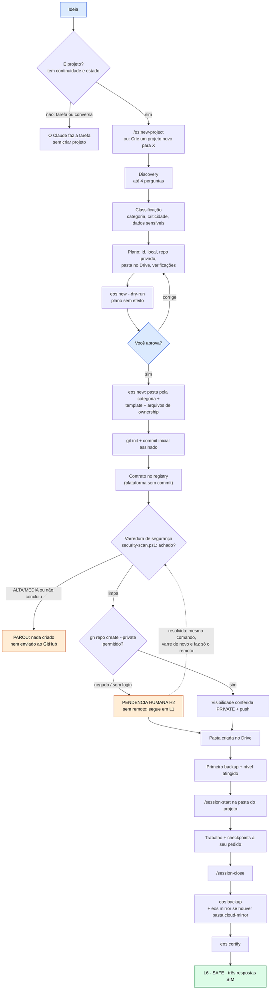
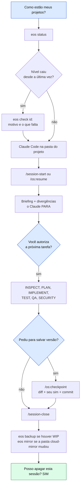
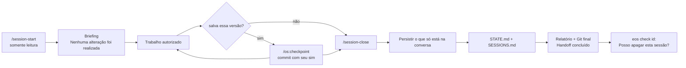
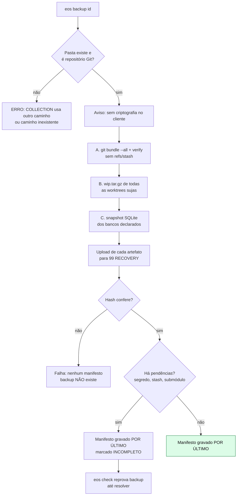
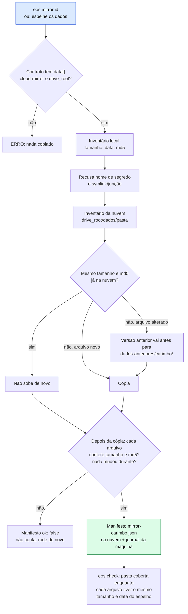
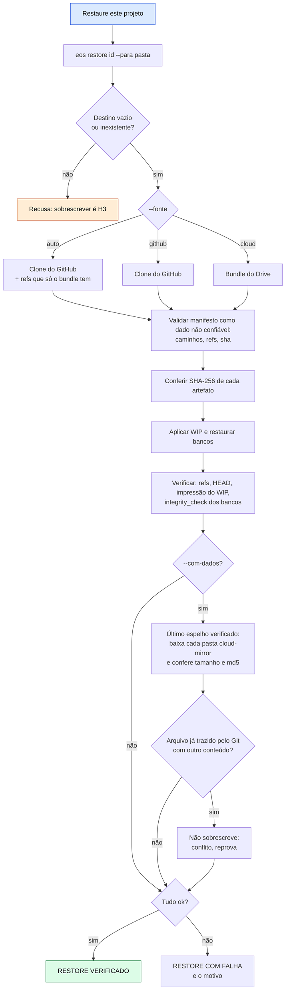
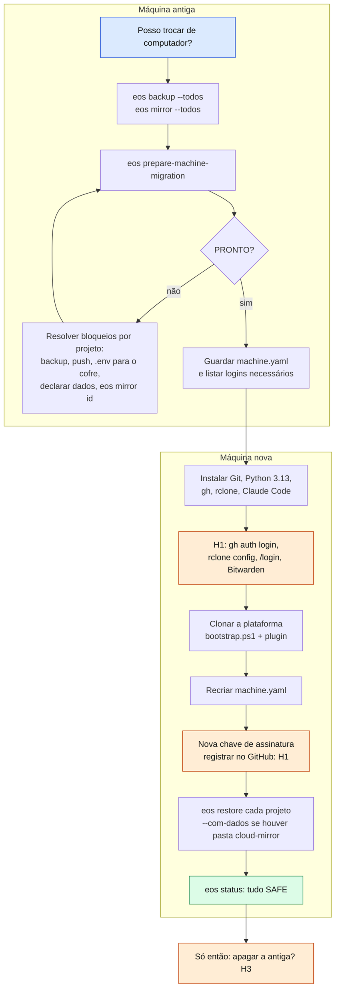
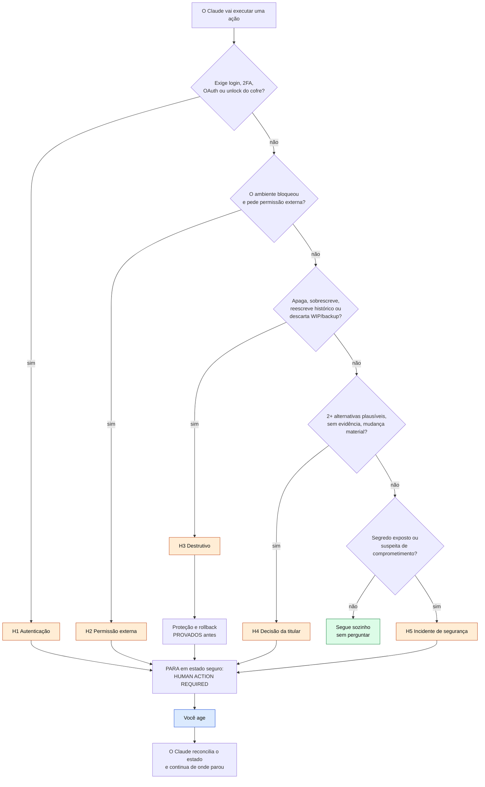
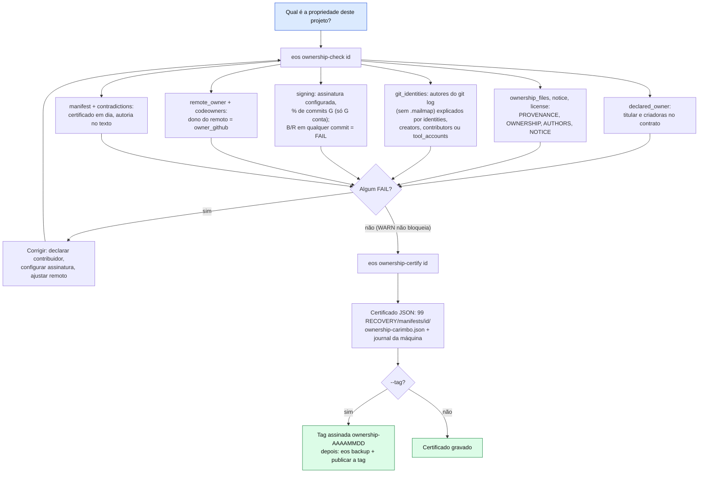
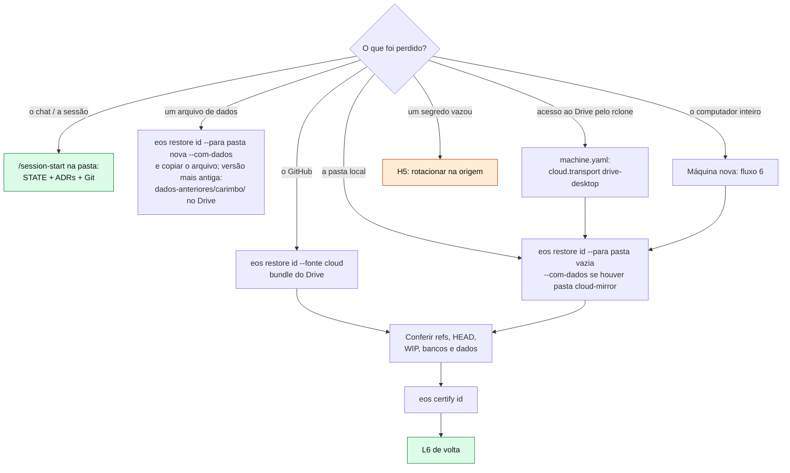

# 04 — Fluxogramas de uso

Os diagramas estão em Mermaid: o GitHub e o VS Code os desenham automaticamente. Legenda das cores:
**azul** = você; **verde** = resultado seguro; **laranja** = o Claude para e pede você (human gate).

Índice: [1. Projeto novo](#1-projeto-novo) · [2. Projeto existente](#2-projeto-existente) ·
[3. Ciclo de sessão](#3-ciclo-de-sessão) · [4. Backup](#4-backup) · [5. Restore](#5-restore) ·
[6. Migração de máquina](#6-migração-de-máquina) · [7. Human gates](#7-human-gates) ·
[8. Ownership](#8-ownership) · [9. Disaster recovery](#9-disaster-recovery)

---

## 1. Projeto novo

---

## 2. Projeto existente

---

## 3. Ciclo de sessão

O `/session-close` **não** commita. Commit é sempre `/os:checkpoint`, a seu pedido.

---

## 4. Backup

O backup protege o projeto. As pastas de dados `cloud-mirror` (fora do Git) têm o próprio
comando, o espelho:

Nada é apagado na nuvem: arquivo que sumiu daqui continua em `dados/`.

---

## 5. Restore

---

## 6. Migração de máquina

---

## 7. Human gates

---

## 8. Ownership

---

## 9. Disaster recovery

Detalhes de cada cenário em [08 — Backup e recovery](08-BACKUP-E-RECOVERY.md). A certificação
(`eos certify`) não baixa as pastas `cloud-mirror`; quem baixa e confere é o
`eos restore ... --com-dados`.
